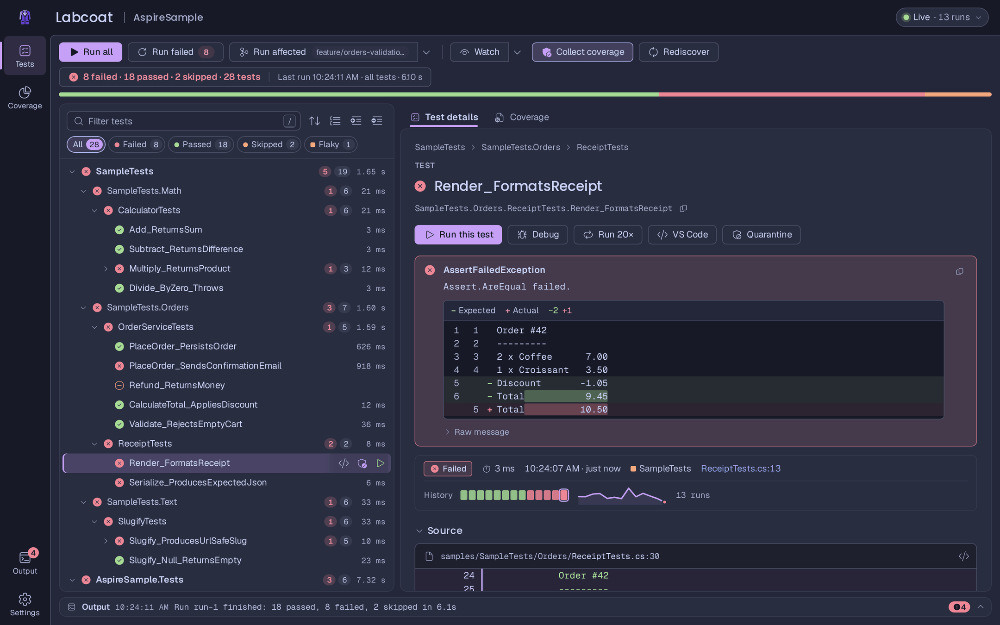

# Labcoat

[](https://github.com/eriklieben/labcoat/actions/workflows/ci.yml)
[](https://www.nuget.org/packages/Labcoat)
[](https://www.nuget.org/packages/Labcoat.Aspire.Hosting)
[](LICENSE)
[](https://github.com/semantic-release/semantic-release)

[](https://sonarcloud.io/summary/new_code?id=eriklieben_labcoat)
[](https://sonarcloud.io/summary/new_code?id=eriklieben_labcoat)
[](https://sonarcloud.io/summary/new_code?id=eriklieben_labcoat)
[](https://sonarcloud.io/summary/new_code?id=eriklieben_labcoat)
[](https://sonarcloud.io/summary/new_code?id=eriklieben_labcoat)

**A web UI for Microsoft.Testing.Platform.** Labcoat finds the test projects in your repository, builds them, and lets
you browse, run and debug their tests in the browser. Run it on its own as a .NET tool, or inside the
[Aspire](https://aspire.dev) dashboard next to the app you are testing.



> **Status:** stable, released on [nuget.org](https://www.nuget.org/packages/Labcoat) (latest version in the badge
> above) and versioned with [Semantic Versioning](https://semver.org). Labcoat needs the .NET 10 SDK. It is tested
> with MSTest 4, NUnit 4.4+, xUnit v3 and TUnit 1 test projects on Microsoft.Testing.Platform: each has a sample in [`samples/`](samples) that CI runs through
> the packaged tool on Linux, Windows and macOS.

## Highlights

- **Live test tree.** Project, namespace, class, method and data row, with results streaming in as tests finish.
  Filter by outcome, search with `is:failed`, `cat:Integration` or `msg:timeout`, sort by duration, group by trait.
- **Failures you can read.** The failing line in its source, clickable stack frames, console output and an
  expected/actual diff for strings, multi-line text and JSON. Open any location in VS Code, Rider or Visual Studio.
- **Fast reruns.** Test hosts stay warm between runs, so rerunning one integration test doesn't restart your app.
- **Watch mode.** On save, Labcoat rebuilds and reruns only the tests affected by the change.
- **Coverage.** Line and branch coverage per file, coverage of a single test, and which tests cover a given line.
- **History.** Results survive restarts. Every test has a run history, flaky tests are flagged, and you can compare
  any two runs. Repeat a test 20 times or quarantine a known-flaky one.
- **Vitest too.** With the `Labcoat.Vitest` package, the Vitest tests of your JavaScript / TypeScript projects run in
  the same tree as the .NET tests. See [docs/runners.md](docs/runners.md).
- **Aspire integration.** A dashboard resource with run, watch and coverage commands, and optional links from each test
  to the traces and logs it caused.
- **Keyboard first.** Command palette (`Ctrl+K`), shortcuts for everything, light and dark mode in seven theme
  families.

| Failure details | Coverage |
| --- | --- |
|  |  |
| **Compare runs** | **Command palette** |
|  |  |

More in [docs/features.md](docs/features.md).

## Quick start

Your test projects must run on Microsoft.Testing.Platform (MTP). For MSTest that is
`<OutputType>Exe</OutputType>` plus `<EnableMSTestRunner>true</EnableMSTestRunner>`; other frameworks are listed under
[Requirements](#requirements).

### On its own

```bash
dnx Labcoat                    # run once without installing (.NET 10 SDK)

dotnet tool install -g Labcoat # or install it as a global tool
labcoat
```

Run it in your repository. It picks the test project in the current directory, or the nearest solution, builds it and
opens http://localhost:4300. For a team, install it as a local tool so everyone gets the same version:

```bash
dotnet new tool-manifest
dotnet tool install Labcoat
dotnet labcoat
```

### In the Aspire dashboard

```bash
dotnet add MyApp.AppHost package Labcoat.Aspire.Hosting
```

```csharp
var builder = DistributedApplication.CreateBuilder(args);

builder.AddProject<Projects.MyApp_Api>("api");
builder.AddLabcoat("tests");              // finds the test projects of the solution

builder.Build().Run();
```

Start the AppHost and open the **Labcoat UI** link on the `tests` resource. See [docs/aspire.md](docs/aspire.md) for
the options, dashboard commands and per-test traces.

### From a test project (preview)

```bash
dotnet add MyApp.Tests package Labcoat.TestingPlatform
dotnet run --project MyApp.Tests -- --labcoat
```

This opens Labcoat for that one project instead of running its tests. See [docs/standalone.md](docs/standalone.md).

## Requirements

- The .NET 10 SDK to run Labcoat. The samples target .NET 10; test projects on older .NET versions should work when
  that runtime is installed, but this isn't tested yet.
- Test projects on Microsoft.Testing.Platform:

| Framework | Project settings | Sample |
| --- | --- | --- |
| MSTest 4 | `<OutputType>Exe</OutputType>` and `<EnableMSTestRunner>true</EnableMSTestRunner>`, or the `MSTest.Sdk` | [SampleTests](samples/SampleTests) |
| NUnit 4.4+ | `<OutputType>Exe</OutputType>` and `<EnableNUnitRunner>true</EnableNUnitRunner>` (NUnit3TestAdapter 6 or later: adapter 5 is on MTP 1.x) | [NUnitSample](samples/NUnitSample) (NUnit 5) |
| xUnit v3 | `<OutputType>Exe</OutputType>`, package `xunit.v3.mtp-v2` and `<UseMicrosoftTestingPlatformRunner>true</UseMicrosoftTestingPlatformRunner>` | [XUnitV3Sample](samples/XUnitV3Sample) |
| TUnit 1 | `<OutputType>Exe</OutputType>` | [TUnitSample](samples/TUnitSample) |
| Vitest 4+ | The `Labcoat.Vitest` runner package, Node.js 20+ and the project's dependencies installed ([docs/runners.md](docs/runners.md)) | [AspireSample.Web](samples/AspireSample/AspireSample.Web) |

Coverage needs `Microsoft.Testing.Extensions.CodeCoverage`. The MSTest and TUnit packages include it; add it to NUnit
and xUnit v3 projects. If a project shows no tests, see [docs/troubleshooting.md](docs/troubleshooting.md). Projects
still on VSTest are listed with the switch for their framework but not run: see
[Migrating from VSTest](docs/migrating-from-vstest.md), including the .NET 10 `global.json` setting that keeps
`dotnet test` working after the switch.

## Packages

| Package | What it is |
| --- | --- |
| [`Labcoat`](src/Labcoat/README.md) | The `labcoat` .NET tool with the web UI. |
| [`Labcoat.Aspire.Hosting`](src/Labcoat.Aspire.Hosting/README.md) | `builder.AddLabcoat(...)` for your AppHost. Includes the runner. |
| [`Labcoat.Testing.MSTest`](src/Labcoat.Testing.MSTest/README.md) | Optional: per-test traces for MSTest + Aspire integration tests, and live console output. |
| [`Labcoat.Testing.TUnit`](src/Labcoat.Testing.TUnit/README.md) | Optional: per-test traces for TUnit + Aspire integration tests (no hooks to write). |
| [`Labcoat.Testing.NUnit`](src/Labcoat.Testing.NUnit/README.md) | Optional: per-test traces for NUnit + Aspire integration tests (no hooks to write), and live console output. |
| [`Labcoat.Testing.XUnit`](src/Labcoat.Testing.XUnit/README.md) | Optional: per-test traces for xUnit v3 + Aspire integration tests (no hooks to write). |
| [`Labcoat.Testing`](src/Labcoat.Testing/README.md) | The framework-neutral core of the four above (brought in by them); for your own hooks in other frameworks. |
| [`Labcoat.TestingPlatform`](src/Labcoat.TestingPlatform/README.md) | Preview: `dotnet run -- --labcoat` for a test project. Includes the runner. |
| [`Labcoat.Vitest`](src/Labcoat.Vitest/README.md) | Optional: runs Vitest projects in Labcoat. Reference it from the AppHost; the tool fetches it on `--runners vitest`. |

Per-test traces take two steps in every framework: add the `Labcoat.Testing.*` package for it, and call
`LabcoatTracing.ConfigureAspireTesting(builder)` in the fixture that creates the Aspire app (see
[docs/aspire.md](docs/aspire.md#per-test-traces-by-test-framework)).

### Verifying packages

Released `.nupkg` and `.snupkg` files carry a signed [build provenance attestation](https://docs.github.com/actions/security-for-github-actions/using-artifact-attestations)
from the GitHub Actions run that built them. Check one with the [GitHub CLI](https://cli.github.com/), for the newest
release (or set `tag` to a release tag such as `v1.0.0`):

```bash
tag=$(gh release view --repo eriklieben/labcoat --json tagName --jq .tagName)   # the newest release
gh release download "$tag" --repo eriklieben/labcoat --pattern '*.nupkg' --dir release
gh attestation verify "release/Labcoat.${tag#v}.nupkg" --repo eriklieben/labcoat
```

Attestations exist only for releases made while the repository is public (the release job skips the step while it
is private), so earlier releases have none.

Verify the files from the GitHub release: nuget.org adds its own repository signature to every package, so the copy
from nuget.org has a different checksum (nuget.org's signature is checked with `dotnet nuget verify` instead).

**Software bill of materials (SBOM).** Every package contains an [SPDX 2.2](https://spdx.dev/) SBOM at
`_manifest/spdx_2.2/manifest.spdx.json`: every file in the package with its SHA-256, and the NuGet packages it depends
on, transitively. `Labcoat`, `Labcoat.Aspire.Hosting` and `Labcoat.TestingPlatform` also contain the web UI's npm
dependencies as a [CycloneDX](https://cyclonedx.org/) SBOM, `sbom/ui.cdx.json` next to the UI's `wwwroot`. Both are
also attached to the GitHub release (`<package>.<version>.spdx.json`, `labcoat-ui.<version>.cdx.json`). The copy
from nuget.org contains the same SBOM:

```bash
unzip -p "release/Labcoat.Testing.${tag#v}.nupkg" _manifest/spdx_2.2/manifest.spdx.json \
  | jq -r '.packages[] | select(.SPDXID != "SPDXRef-RootPackage") | "\(.name) \(.versionInfo)"' | sort
```

Releases made while the repository is public also carry a signed SBOM attestation for each package:

```bash
gh attestation verify "release/Labcoat.${tag#v}.nupkg" --repo eriklieben/labcoat --predicate-type https://spdx.dev/Document/v2.2
gh attestation verify "release/Labcoat.${tag#v}.nupkg" --repo eriklieben/labcoat --predicate-type https://cyclonedx.org/bom
```

## Documentation

| | |
| --- | --- |
| [Getting started](docs/getting-started.md) | Install, first run, the samples. |
| [Features](docs/features.md) | The test tree, failures, watch mode, coverage, history, shortcuts. |
| [Aspire](docs/aspire.md) | The hosting integration, dashboard commands, per-test traces and logs. |
| [Standalone](docs/standalone.md) | `dnx`, global and local tool, the `--labcoat` extension. |
| [Configuration](docs/configuration.md) | Command-line options, environment variables, settings. |
| [Themes](docs/themes.md) | The theme families and how to customize colors. |
| [Migrating from VSTest](docs/migrating-from-vstest.md) | The switch per framework, `global.json` for `dotnet test`, coverage. |
| [Troubleshooting](docs/troubleshooting.md) | No tests found, VSTest projects, ports, Windows notes. |
| [How it works](docs/protocol.md) | Host internals and the MTP server-mode protocol. |
| [API contract](docs/contract.md) | The REST and WebSocket API between the UI and the host. |

## Contributing

Contributions are welcome. The maintainer decides what goes into Labcoat, so please open an issue or a discussion
before working on anything bigger than a small fix ([what goes into Labcoat](CONTRIBUTING.md#what-goes-into-labcoat)).
[CONTRIBUTING.md](CONTRIBUTING.md) explains how to build from source, the checks, the
conventions and the commit message format that drives the automated releases. Please follow the [Code of Conduct](CODE_OF_CONDUCT.md), report vulnerabilities as described in
[SECURITY.md](SECURITY.md), and see [CHANGELOG.md](CHANGELOG.md) for what changed.

## License

[MIT](LICENSE). Third-party notices, including the Aspire dashboard design tokens and the bundled fonts, are in
[THIRD-PARTY-NOTICES.md](THIRD-PARTY-NOTICES.md).

Labcoat is a community project and is not affiliated with or endorsed by Microsoft or the .NET Foundation.
