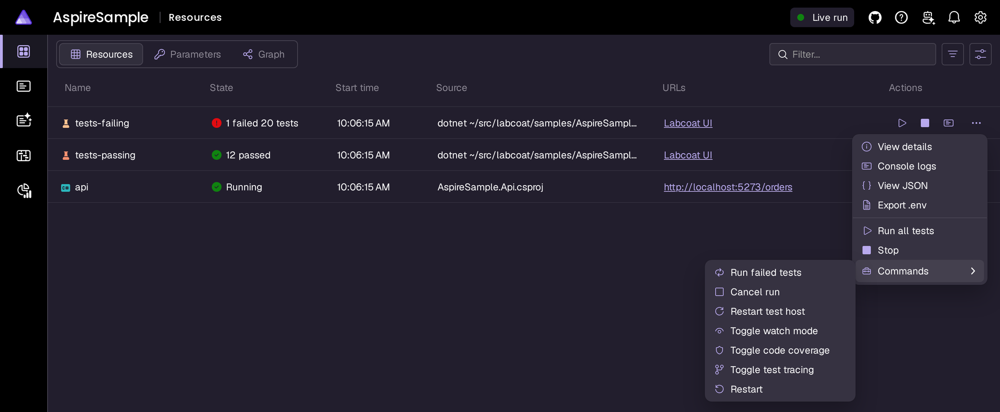
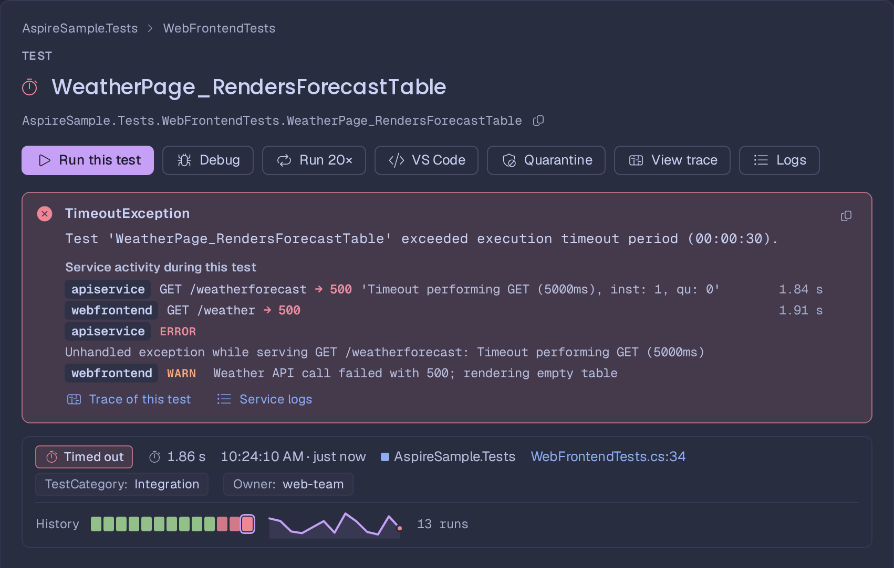
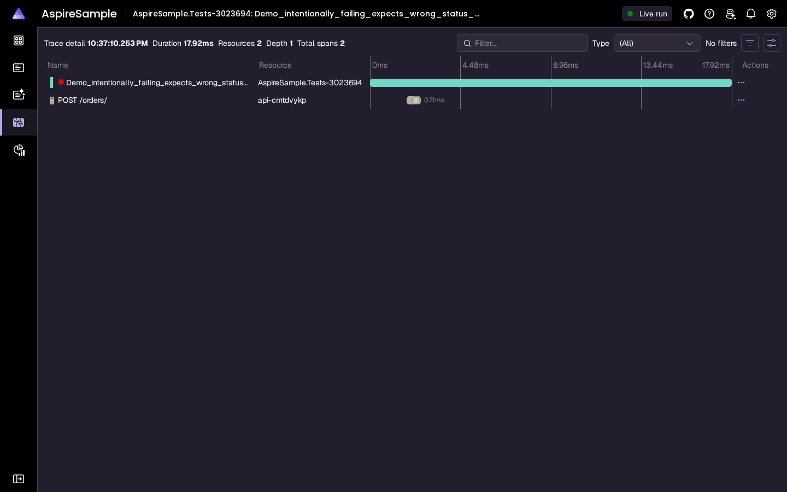

# Labcoat in the Aspire dashboard

`Labcoat.Aspire.Hosting` adds Labcoat to your AppHost as a dashboard resource. You get a **Labcoat UI** link, commands to
run tests from the dashboard, the suite result in the resource's state, and optional links from each test to the
traces and logs it caused.

## Install

```bash
dotnet add MyApp.AppHost package Labcoat.Aspire.Hosting
```

The package contains Labcoat itself. On build it is copied to your AppHost's output folder
(`bin/<config>/<tfm>/labcoat/`) and started from there with `dotnet`, so there is nothing else to install. It needs the
.NET 10 runtime and Aspire 13.4.5 or later (`Aspire.Hosting` ≥ 13.4.5; your AppHost SDK decides the version you run).

## Usage

```csharp
var builder = DistributedApplication.CreateBuilder(args);

var api = builder.AddProject<Projects.MyApp_Api>("api");

builder.AddLabcoat("tests");     // scans the solution for test projects

builder.Build().Run();
```

Options:

```csharp
builder.AddLabcoat("tests")
       .WithTestProject("../MyApp.Tests")   // repeatable: a .csproj, solution or directory, relative to the AppHost
       .WithTestProject("../MyApp.IntegrationTests")
       .WithWatch()                         // start with watch mode on
       .WithCoverage()                      // start with code coverage on
       .WithTestTracing()                   // start with per-test traces on (see below)
       .WithAffectedBase("origin/develop")  // the base of "Run affected → Branch vs …" (default: origin/HEAD)
       .WithImpactMap("test")               // impact map per test: "class", "test" or "auto" (default)
       .WithMaxParallelProjects(2)          // test projects discovered / run at once (default: processors, max 4)
       .WithHangThreshold(TimeSpan.FromMinutes(2))  // "possibly hanging" after 2 min (default 60 s; Zero = never)
       .WithTestTimeout(TimeSpan.FromMinutes(5))    // a test running longer times out, its project's run is cancelled
       .WithHostPort(4300)                  // a fixed port instead of a random one
       .WithPassThroughEnvironment("OTEL_*"); // keep variables the tests would otherwise not get (see below)
```

Or all in one place, with defaults for the Labcoat UI's settings:

```csharp
builder.AddLabcoat("tests", labcoat =>
{
    labcoat.TestProjects.Add("../MyApp.Tests");
    labcoat.Watch = true;
    labcoat.Coverage = true;
    labcoat.CoverageExclude.Add("MyApp.Tools");      // coverage filters; also CoverageInclude, CoverageSettings
    labcoat.TestTracing = true;
    labcoat.HostPort = 4300;
    labcoat.AffectedBase = "origin/develop";        // appsettings.json: "Labcoat": { "AffectedBase": "origin/develop" }
    labcoat.ImpactMap = "auto";                     // "class", "test" or "auto" (features.md "The impact map")
    labcoat.MaxParallelProjects = 2;                // appsettings.json: "MaxParallelProjects": 2
    labcoat.HangThreshold = TimeSpan.FromMinutes(2); // appsettings.json: "HangThreshold": "2m" (or "00:02:00", seconds)
    labcoat.TestTimeout = TimeSpan.FromMinutes(5);  // appsettings.json: "TestTimeout": "5m"; off by default
    labcoat.PassThroughEnvironment.Add("ASPIRE_ALLOW_UNSECURED_TRANSPORT"); // see "The tests' environment"

    labcoat.Ui.Theme = LabcoatTheme.Aspire;         // Catppuccin, Aspire, GitHub, One, Dracula, Solarized, Gruvbox
    labcoat.Ui.Mode = LabcoatThemeMode.Dark;        // System, Light, Dark
    labcoat.Ui.Editor = LabcoatEditor.Rider;        // VSCode, Rider, VisualStudio
    labcoat.Ui.Confetti = true;
    labcoat.Ui.Lock(s => s.Editor);                 // the team uses Rider: not changeable in the browser
});
```

The fluent methods keep working and can be mixed with the options (a fluent call after `AddLabcoat` wins).

`MaxParallelProjects`, `HangThreshold` and `TestTimeout` are Labcoat's `maxParallelProjects`, `hangThreshold` and
`testTimeout` (passed as `LABCOAT_MAX_PARALLEL`, `LABCOAT_HANG_THRESHOLD`, `LABCOAT_TEST_TIMEOUT`); see
[configuration.md](configuration.md#parallel-projects-slow-tests-and-timeouts). A test timeout is per test; MTP's
`--timeout` in a project's `TestingPlatformCommandLineArguments` limits each run of that project.

Without `WithTestProject`, Labcoat scans the solution root: the directory of the nearest `.slnx`/`.sln` walking up from
the AppHost directory, or else the AppHost's parent directory. The solution root is also the boundary for the source
files the UI may show (for example files from stack traces).

You can add several Labcoat resources, for example one per test suite. The
[AspireSample](../samples/AspireSample) has two: `tests-passing` and `tests-failing`.

## The tests' environment

Labcoat runs your tests with the environment `dotnet test` gets in the terminal you started `aspire run` from. The
Labcoat resource itself inherits the variables of the Aspire run, and test processes leave these out:

| Left out | Why |
| --- | --- |
| `ASPIRE_*` (e.g. `ASPIRE_BACKCHANNEL_PATH`, `ASPIRE_CLI_PID`, `ASPIRE_DASHBOARD_OTLP_ENDPOINT_URL`, `ASPIRE_RESOURCE_SERVICE_ENDPOINT_URL`, `ASPIRE_DCP_PATH`, `ASPIRE_DASHBOARD_URL`), `AspireCliPath`, `AspireCliBundlePath` | Set by the `aspire` CLI and the AppHost's launch profile for this run. A nested AppHost in a test (`DistributedApplicationTestingBuilder`, a publish) would talk to the outer CLI and hang, `aspire stop` would list the test host as an AppHost, and app-model snapshots would contain the dashboard's addresses. |
| `DOTNET_DASHBOARD_*`, `DOTNET_RESOURCE_SERVICE_*` | The same, under the names older launch profiles use. |
| `DCP_*`, `DEBUG_SESSION_*`, `DOTNET_WATCH*`, `DOTNET_HOTRELOAD_*`, `DOTNET_MODIFIABLE_ASSEMBLIES`, dotnet watch's hot reload `DOTNET_STARTUP_HOOKS` entry | The orchestrator's, the IDE's debug session's and `dotnet watch`'s. |
| `OTEL_*` | `WithOtlpExporter()` on the Labcoat resource: they describe Labcoat, not your tests. Per-test traces use `LABCOAT_OTLP_*` instead (below). |
| `PORT`, `ASPNETCORE_URLS`, `ASPNETCORE_HTTP(S)_PORTS`, `DOTNET_URLS`, `DOTNET_LAUNCH_PROFILE` | Labcoat's own listen address; a test that starts Kestrel from configuration would try to bind it. |
| `LABCOAT_TOKEN`, `LABCOAT_NAME`, `LABCOAT_ALLOWED_*`, `LABCOAT_DASHBOARD_API_*`, `LABCOAT_APPHOST_UI_SETTINGS`, `LABCOAT_AFFECTED_BASE`, `LABCOAT_IMPACT_MAP`, `LABCOAT_MAX_PARALLEL`, `LABCOAT_HANG_THRESHOLD`, `LABCOAT_TEST_TIMEOUT` | Labcoat's own settings. |

Everything else is passed on: variables you add with `WithEnvironment` (`DOCKER_HOST`, ...), connection strings and
`services__*` from `WithReference`, `ASPNETCORE_ENVIRONMENT` / `DOTNET_ENVIRONMENT`, `SSL_CERT_DIR`, and Aspire settings
that belong to the machine rather than the run (`ASPIRE_CONTAINER_RUNTIME`, `DOTNET_ASPIRE_CONTAINER_RUNTIME`,
`ASPIRE_DEPENDENCY_CHECK_TIMEOUT`, ...). Labcoat logs the names it left out once, at the first test host start.

Inside the Labcoat process an inherited variable and one you set on the resource look the same, so a variable you set on
purpose whose name is on the list above is left out too. Keep it with an allow-list (names, or a `PREFIX*`):

```csharp
builder.AddLabcoat("tests")
       .WithPassThroughEnvironment("ASPIRE_ALLOW_UNSECURED_TRANSPORT", "OTEL_*")  // keep these for the tests
       .WithTestEnvironment("ASPNETCORE_URLS", "http://localhost:5099");          // set one for the tests and keep it
```

`PassThroughEnvironment` in the options or in appsettings.json (`"Labcoat": { "PassThroughEnvironment": ["OTEL_*"] }`)
does the same. The integration passes the list to Labcoat as `LABCOAT_TEST_ENV_PASSTHROUGH`.

## UI settings

Everything on Labcoat's Settings page can get a default from the AppHost, in the `AddLabcoat` options (above) or with
`WithUiSettings`:

```csharp
builder.AddLabcoat("tests")
       .WithUiSettings(ui =>
       {
           ui.Theme = LabcoatTheme.Dracula;
           ui.Mode = LabcoatThemeMode.Dark;
           ui.Motion = LabcoatMotion.Reduced;              // System, Reduced, Off
           ui.Editor = LabcoatEditor.Rider;
           ui.CoverageTint = LabcoatCoverageTint.Gutter;   // Line, Gutter
           ui.Confetti = true;
           ui.PartialRunsInHistory = true;
           ui.OpenOutputOnError = true;
           ui.SingleKeyShortcuts = false;
           ui.Lock(s => s.Theme);                          // or ui.Lock(LabcoatUiSetting.Theme, …), ui.LockAll()
       });
```

- **Defaults, not overrides.** A choice made in the browser wins over a default. Unset properties keep the UI's
  built-in default (or a value from a `.labcoat.json`).
- **Locks** pin a setting for everyone: the Settings page shows it disabled with *Set by the AppHost (Program.cs)*,
  and the browser's own choice is ignored. A locked setting without a value is locked to the built-in default.
- **appsettings.json** works too. The section `Labcoat` applies to every Labcoat resource, `Labcoat:Resources:<name>`
  to one; the `configure` callback runs after the binding, so code wins:

  ```json
  {
    "Labcoat": {
      "Ui": { "Theme": "Aspire", "Editor": "Rider", "Locked": [ "Editor" ] },
      "Resources": { "tests-failing": { "Watch": true, "Ui": { "OpenOutputOnError": true } } }
    }
  }
  ```

  An invalid value (`"Theme": "Neon"`) stops the AppHost with an error naming the key.
- The integration passes the settings to Labcoat as `LABCOAT_APPHOST_UI_SETTINGS` (compact JSON). Labcoat merges them
  with the user's `~/.labcoat.json` and the repository's `.labcoat.json`: the AppHost wins over both files,
  `LABCOAT_UI_SETTINGS` and CLI flags win over the AppHost. See [configuration.md](configuration.md#ui-settings) for
  the full list and the precedence.

## In the dashboard



- Resource type **Labcoat** with a **Labcoat UI** URL that opens the UI. The UI links back to the dashboard.
- Health check against `/api/health` (cheap; no state snapshot).
- The **state** column shows the suite result once the explorer is ready: `✓ 12 passed`, `✕ 1 failed · 20 tests`
  (error style), `▶ Running 3/20`, `◼ Cancelling…`, `◌ Building`, `○ 20 tests · not run` (polled from `/api/summary` every
  2 s). A custom
  state replaces "Running", so the dashboard shows no health status for the resource then (Aspire computes health for
  "Running" only); `.WithSuiteResultState(false)` keeps the plain "Running" state.
- Commands (enabled while the resource is running):
  - **Run all tests**: builds and runs every test, waits for exactly that run (by the `runId` `/api/run` returns; a
    request merged into a queued run reports that run) and reports `N tests: x passed, y failed, z skipped` (failure
    style when tests failed, the run was aborted by a crashed test host, cancelled, or nothing could run).
  - **Run failed tests**: re-runs the tests that failed / timed out in the last run.
  - **Cancel run**: cancels the running run and clears the queued one; the warm test host is kept when the tests stop
    in time.
  - **Restart test host**: stops the warm test host(s) and starts fresh ones; a hung run is cancelled first.
  - **Toggle watch mode**
  - **Toggle code coverage**
  - **Toggle test tracing**
- The Labcoat UI shows the resource name (e.g. `tests`) as its workspace name.
- Security: the integration passes a random per-run `LABCOAT_TOKEN` and the endpoint host (`LABCOAT_ALLOWED_HOSTS`) to
  the explorer; the commands send the token as `X-Labcoat-Token`. Scripts that call the API without a browser `Origin`
  need it too (see [SECURITY.md](../SECURITY.md)). The proxied endpoint passes the browser's `Host` header through unchanged, so the
  dashboard's "Labcoat UI" link (same origin) works as is.

## Traces and logs per test (opt-in)

Trace collection is **off by default**. Turned on, it lets you jump from a failing integration test to the service
traces/logs it caused in the Aspire dashboard, and Labcoat shows that test's error spans and warning/error logs inline
next to the failure. Turn it on with `.WithTestTracing()`, the **Toggle test tracing** command, or the toggle in the
Labcoat UI; a choice made at runtime is remembered per workspace (and wins over `WithTestTracing()` on the next start).

The Labcoat resource always gets the dashboard's OTLP settings (`WithOtlpExporter()`), but only while tracing is on
does Labcoat pass them to the test hosts as `LABCOAT_OTLP_ENDPOINT` / `LABCOAT_OTLP_PROTOCOL` / `LABCOAT_OTLP_HEADERS`
(the `OTEL_*` variables themselves are never passed on; toggling restarts warm test hosts on their next run). The
integration also passes the dashboard URL and its API key (`LABCOAT_DASHBOARD_API_URL` / `LABCOAT_DASHBOARD_API_KEY`,
from `AppHost:DashboardApiKey`) so Labcoat can read a test's spans and logs from the dashboard's telemetry API. Tests
that use a `Labcoat.Testing` adapter report a trace id per test, and the UI links each test to
`/traces/detail/<traceId>` and `/structuredlogs?traceId=<traceId>` in this dashboard (see
[per-test traces by test framework](#per-test-traces-by-test-framework) for the setup). In every framework, the fixture
that starts the app sends the services' telemetry to this dashboard too:

```csharp
var builder = await DistributedApplicationTestingBuilder.CreateAsync<Projects.MyAppHost>(ct);
LabcoatTracing.ConfigureAspireTesting(builder);   // using Labcoat.Testing;
```

Without an adapter (or with tracing off) tests have no trace id; the UI still links to the dashboard.


With tracing on, a failed integration test shows the error spans and warning/error logs of the services it called
right under the failure, with links to the full trace and the structured logs:





### Per-test traces by test framework

The test-side half is a small package per test framework on top of
[`Labcoat.Testing`](../src/Labcoat.Testing/README.md), the framework-neutral core. Everything in them is a no-op unless
the tests run under Labcoat hosted by an AppHost with tracing on, so they are safe to leave in place for `dotnet test`
and CI. Each test gets its own trace: a span named after the test (exported under the test assembly's name, tagged
`test.class`, `test.name`, `test.outcome`, ...), `labcoat:traceId=<hex>` in the test's output (Labcoat strips that
line), and HTTP calls made during the test carry the W3C `traceparent` header, so the spans of the services the test
calls join the test's trace.

> [!IMPORTANT]
> **Two steps, in every framework:**
>
> 1. **Add the package for your test framework** (table below). For TUnit, NUnit and xUnit v3 that is all step 1 takes;
>    MSTest also needs two hooks.
> 2. **Call `LabcoatTracing.ConfigureAspireTesting(builder)` in the fixture that creates the app**, after `CreateAsync`
>    and before `BuildAsync`. No package does this for you: without it the services the tests start send their
>    telemetry to the testing default (`localhost:4317`, usually nothing), and the dashboard shows the test's span but
>    none of the services' spans or logs.
>
>    ```csharp
>    using Labcoat.Testing;
>
>    var builder = await DistributedApplicationTestingBuilder.CreateAsync<Projects.MyAppHost>(ct);
>    LabcoatTracing.ConfigureAspireTesting(builder);
>    var app = await builder.BuildAsync(ct);
>    ```

| Framework | Step 1: package | Step 1: code | Step 2: `ConfigureAspireTesting` in |
| --- | --- | --- | --- |
| MSTest | [`Labcoat.Testing.MSTest`](../src/Labcoat.Testing.MSTest/README.md) | Two hooks (below) or derive from `LabcoatTracedTest`. | the fixture that starts the app, e.g. `[AssemblyInitialize]` |
| TUnit | [`Labcoat.Testing.TUnit`](../src/Labcoat.Testing.TUnit/README.md) | None: the package adds `[assembly: LabcoatTracing]`. | the shared class the tests start the app from |
| NUnit 4.4+ | [`Labcoat.Testing.NUnit`](../src/Labcoat.Testing.NUnit/README.md) | None: the package adds `[assembly: LabcoatTracing]`. | the `[OneTimeSetUp]` of a `[SetUpFixture]` |
| xUnit v3 (3.2+) | [`Labcoat.Testing.XUnit`](../src/Labcoat.Testing.XUnit/README.md) | None: the package adds `[assembly: LabcoatTracing]`. | an assembly fixture's `InitializeAsync` |
| Other | [`Labcoat.Testing`](../src/Labcoat.Testing/README.md) | Call `LabcoatTracing.BeginTest` / `EndTest` from your own hooks ([ARCHITECTURE.md](../src/Labcoat.Testing/ARCHITECTURE.md)). | the fixture that starts the app |

The sections below are step 1 per framework; the fixtures of `samples/AspireSample` (listed at the end of this section)
show step 2 in context.

**MSTest**

```bash
dotnet add MyApp.Tests package Labcoat.Testing.MSTest
```

```csharp
[TestClass]
public static class LabcoatHooks
{
    [GlobalTestInitialize] public static void Start(TestContext c) => LabcoatMSTest.StartTest(c);
    [GlobalTestCleanup]    public static void End(TestContext c)   => LabcoatMSTest.EndTest(c);
}
```

**TUnit**

```bash
dotnet add MyApp.Tests package Labcoat.Testing.TUnit
```

No code besides step 2: the adapter adopts the `Activity` TUnit starts for each test (current in the test body) and tags
it with `test.id`, the test's id in Labcoat. To trace only some tests, set
`<LabcoatTracingAutoRegister>false</LabcoatTracingAutoRegister>` and put `[LabcoatTracing]` on those classes.

**NUnit** (on Microsoft.Testing.Platform: NUnit3TestAdapter 6 or later with `<EnableNUnitRunner>true</EnableNUnitRunner>`)

```bash
dotnet add MyApp.Tests package Labcoat.Testing.NUnit
```

No code besides step 2: the package's `[assembly: LabcoatTracing]` is an NUnit action attribute around every test. It
starts the span before `[SetUp]` (current in the test body) and ends it after `[TearDown]`, tagged with NUnit's outcome.
`test.id` is the test's full name, which is also its id in Labcoat (data rows included). NUnit attaches output to a
test's result only when it ends: `LabcoatOutput.WriteLine(...)` / `LabcoatOutput.CreateWriter()` also show a line live
under the test while it runs.

**xUnit v3** (on Microsoft.Testing.Platform: `xunit.v3.mtp-v2`)

```bash
dotnet add MyApp.Tests package Labcoat.Testing.XUnit
```

No code besides step 2: the package's `[assembly: LabcoatTracing]` is an xUnit `BeforeAfterTestAttribute`. It starts the
span right before the test method (after the constructor and `InitializeAsync`) and ends it right after, tagged with
xUnit's outcome. The trace id goes to the test's `ITestOutputHelper` output. `test.id` is the test case's unique id,
which is also its id in Labcoat; theory data that xUnit can't serialize runs as one row in Labcoat (each data row still
gets its own trace; the row links to the last one). Live output needs nothing extra: Labcoat streams xUnit's own live
output.

For NUnit and xUnit, set `<LabcoatTracingAutoRegister>false</LabcoatTracingAutoRegister>` and put `[LabcoatTracing]` on
some classes to trace only those, as with TUnit.

**Migrating from `Labcoat.Testing` before 1.0 (MSTest):** reference `Labcoat.Testing.MSTest` instead of
`Labcoat.Testing` and change `LabcoatTracing.StartTest` / `EndTest` in the hooks to `LabcoatMSTest.StartTest` /
`EndTest`. `LabcoatTracing.ConfigureAspireTesting`, `LabcoatTracedTest`, `LabcoatOutput` and the namespace are
unchanged.

The sample (`samples/AspireSample`) has all four: `AspireSample.Tests` / `AspireSample.PassingTests` on MSTest,
`AspireSample.TUnitTests` on TUnit, `AspireSample.NUnitTests` on NUnit and `AspireSample.XUnitTests` on xUnit v3.

## Integration tests and warm test hosts

Labcoat keeps each test process alive between runs ("warm"), so an Aspire app started by your tests can stay up and
the next run takes milliseconds. Two things make that work:

1. **Start the app once.** Keep the `DistributedApplication` in a static field and start it on first use.
2. **Don't dispose it after every run.** MSTest runs `[ClassCleanup]` and `[AssemblyCleanup]` at the end of every run
   request. When `LABCOAT_WARM_HOST=1` is set (Labcoat sets it on its test hosts), skip the disposal there and dispose
   on process exit instead:

```csharp
private static bool WarmHost => Environment.GetEnvironmentVariable("LABCOAT_WARM_HOST") == "1";

// after starting the app:
AppDomain.CurrentDomain.ProcessExit += (_, _) => _app?.DisposeAsync().AsTask().Wait(TimeSpan.FromSeconds(30));

[AssemblyCleanup]
public static async Task StopAsync()
{
    if (WarmHost) return;            // kept for the next run, disposed on process exit
    if (_app is not null) await _app.DisposeAsync();
}
```

[`AspireAppFixture.cs`](../samples/AspireSample/AspireSample.Tests/Integration/AspireAppFixture.cs) in the sample is a
complete version. Labcoat replaces a warm host when the build output changes, when an assembly it has loaded is
rewritten on disk (a build outside Labcoat, code coverage; see below), when it crashes, or when you use
**Restart test host**.

**Coverage runs don't use the warm host.** Code coverage (`Microsoft.Testing.Extensions.CodeCoverage`) runs the test
app behind a test host controller that starts the real test process with the coverage profiler attached and writes the
report when that process exits. That can't happen in a process that is already running, so every coverage run is a new
process (with a fresh copy of your fixtures, e.g. a new Aspire app or database container). The warm host is kept for
the next run without coverage: Labcoat uses dynamic instrumentation (the CLR profiler) where the extension ships one
for the platform (Windows, linux-x64, osx-x64; Microsoft.Testing.Extensions.CodeCoverage 18.11 or later on Linux /
macOS), so no assembly is rewritten and the warm host stays warm. Elsewhere the extension instruments the assemblies in
place, so Labcoat stops the warm host before the coverage run and starts a fresh one after it (its fixtures start over
once). To keep coverage runs from costing a fixture start, turn coverage on only when you look at coverage (the
**Toggle code coverage** command).

**Which code counts.** A test project's own `coverage.settings.xml` (or `CodeCoverage.xml`, `*.runsettings`, …) is
used as it is, so the numbers match `dotnet test --coverage --coverage-settings`; without one, Labcoat counts the
projects the test project references and leaves out Labcoat's own assemblies (Labcoat.Aspire.Hosting,
Labcoat.Testing, …), test frameworks and generated code. Choose a file or add filters from the AppHost:

```csharp
builder.AddLabcoat("tests", o =>
{
    o.TestProjects.Add("../../tests/MyApp.Tests");
    o.CoverageSettings = "coverage.settings.xml";      // per test project, or a path under the AppHost directory
    o.CoverageExclude.Add("MyApp.DemoDataSeeder");     // module names or path globs
    o.CoverageExclude.Add("**/Migrations/**");
});
// or: .WithCoverageSettings("coverage.settings.xml").WithCoverageFilter(exclude: ["MyApp.DemoDataSeeder"])
```

See [Which code counts](features.md#which-code-counts) for the full rules.

## Notes

- The explorer builds and runs your test projects. Integration tests built on `Aspire.Hosting.Testing` reference the
  AppHost, so the explorer rebuilds the AppHost while it is running. That is fine on Linux/macOS; on Windows a rebuild
  may fail with "file in use" if the AppHost's own code changed while it runs (restart the AppHost then).
- When the AppHost is started by `Aspire.Hosting.Testing` (your integration tests), `AddLabcoat` does not add the
  resource, so test runs don't start a nested explorer. It is also not part of publish/deploy manifests.
- If the bundled explorer is missing from the output folder (e.g. `LabcoatCopyBundle=false`), the integration
  falls back to `dotnet tool exec Labcoat@<version> --yes -- ...` (the version of `Labcoat.Aspire.Hosting`), which
  needs that version of the `Labcoat` tool package to be available from your NuGet feeds.
- Using the integration from source (ProjectReference instead of the package)? Reference
  `Labcoat.Aspire.Hosting.csproj` with `IsAspireProjectResource="false"`; its build publishes `src/Labcoat` and
  places it under `labcoat/` in the AppHost's output, the same layout as the package.

See also: [configuration.md](configuration.md) for the environment variables, [troubleshooting.md](troubleshooting.md).
