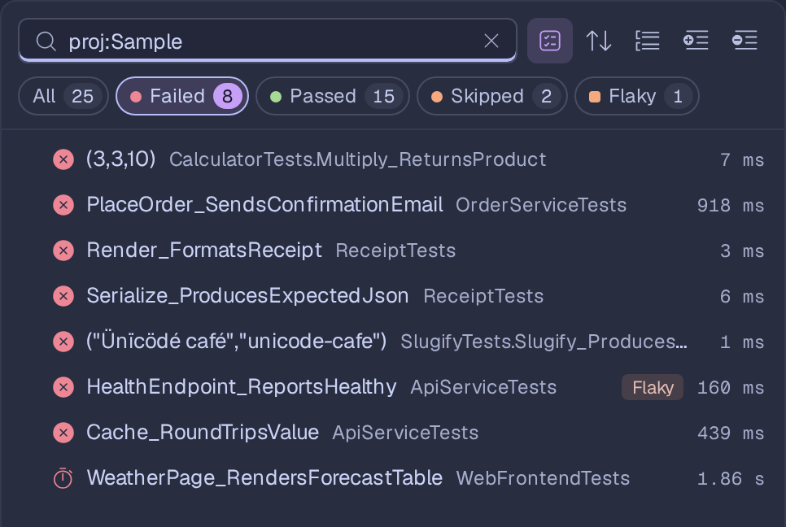
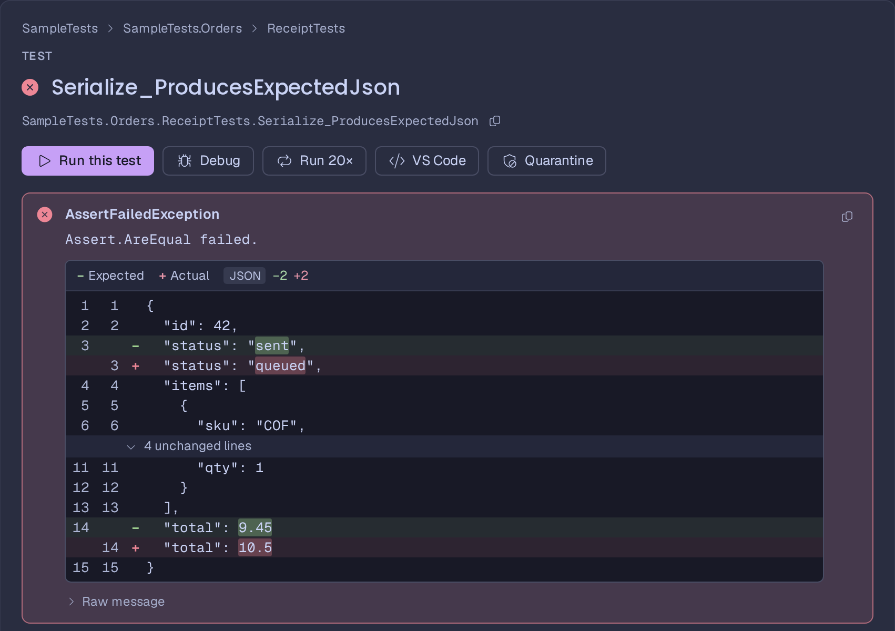
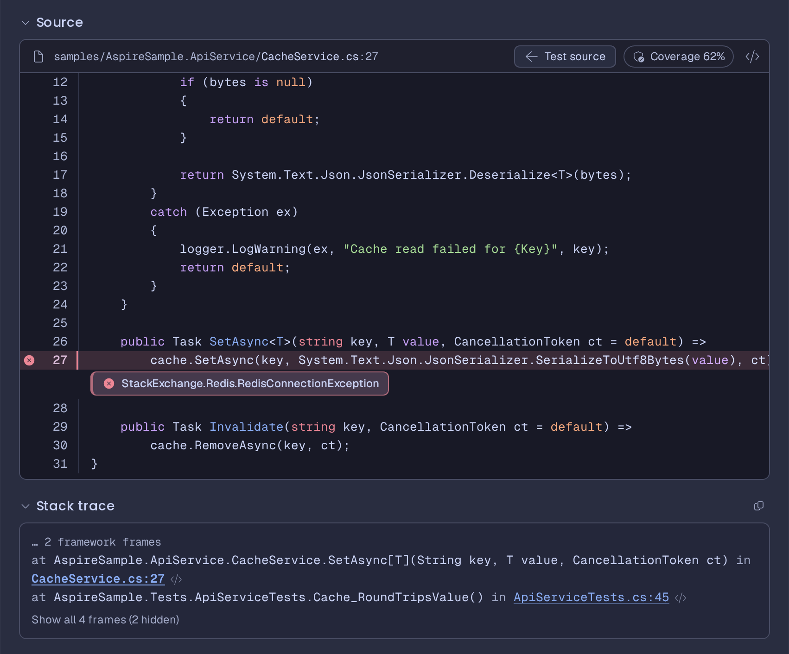
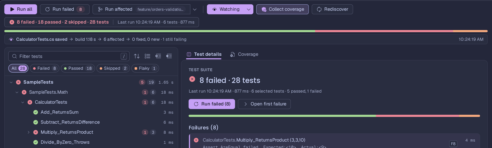
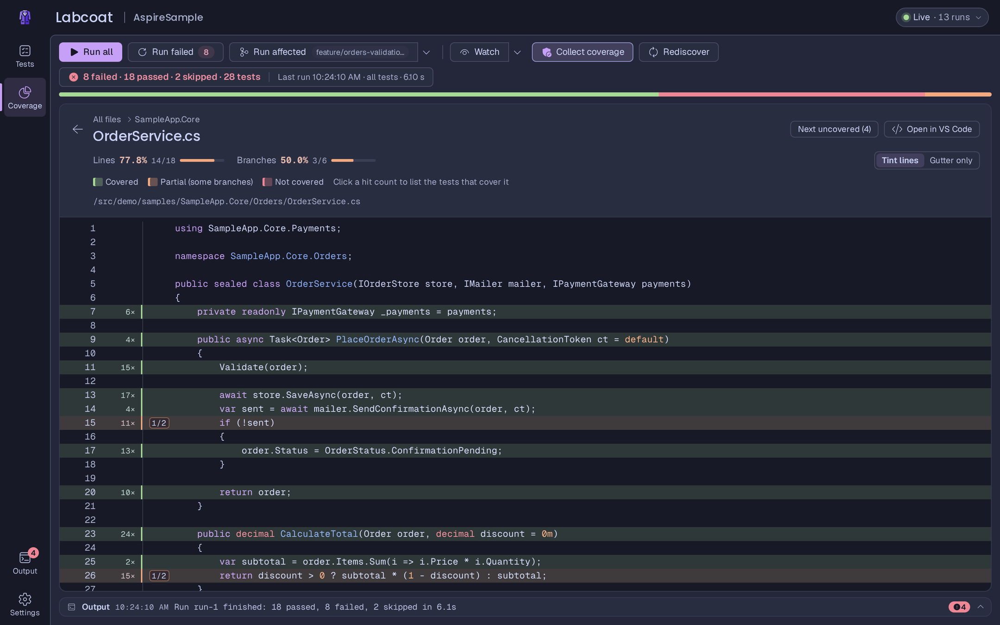
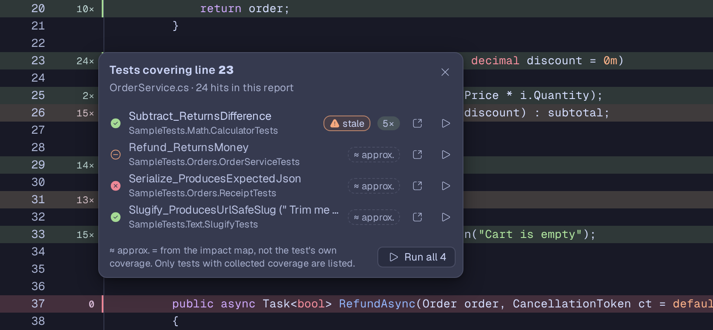
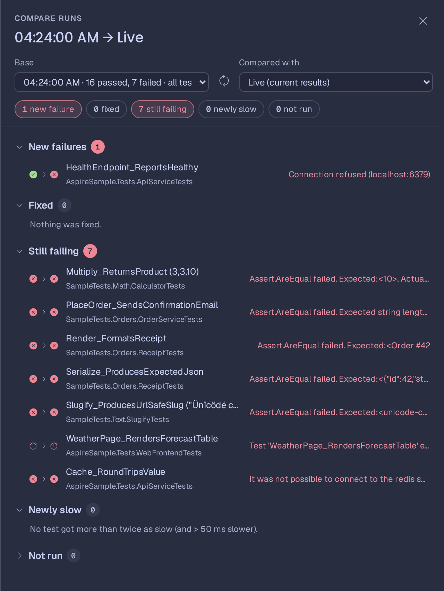
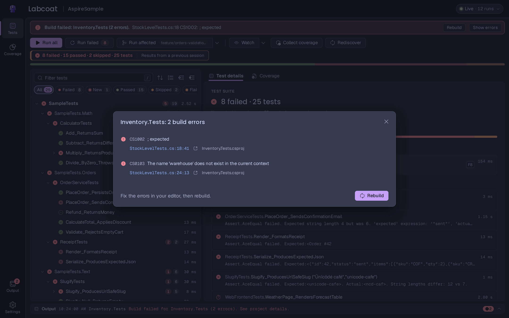
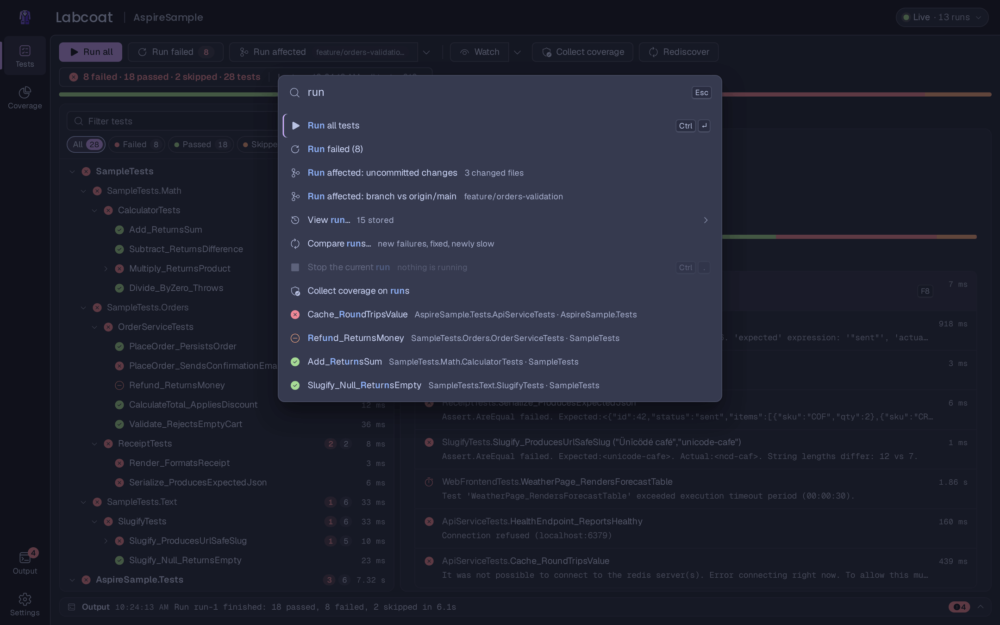
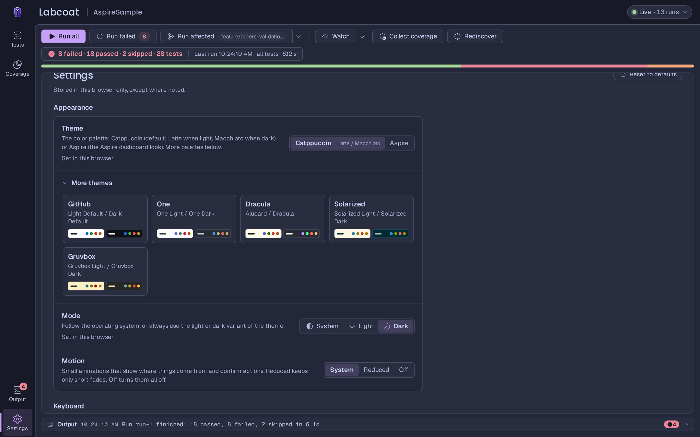

# Features

A tour of the Labcoat UI. Most actions have a keyboard shortcut; press `?` in the UI for the list, or see
[Keyboard shortcuts](#keyboard-shortcuts) below.

- [The test tree](#the-test-tree)
- [Running tests](#running-tests)
- [Failure details](#failure-details)
- [Snapshot testing](#snapshot-testing)
- [Run affected tests](#run-affected-tests)
- [Watch mode](#watch-mode)
- [Code coverage](#code-coverage)
- [History, flaky tests and past runs](#history-flaky-tests-and-past-runs)
- [Build errors and diagnostics](#build-errors-and-diagnostics)
- [Keyboard shortcuts and the command palette](#keyboard-shortcuts)
- [Editor integration](#editor-integration)
- [Settings](#settings)

## The test tree



Tests are shown as project › namespace › class › method, with a row per data row of a parameterized test. Each row
shows its status, the number of failed and total tests below it, and the duration. Results stream in while a run is in
progress.

- **Filter chips:** All, Failed, New, Passed, Skipped, Flaky, Not run. With a filter on, the tree turns into a flat
  list of matching tests (**Show as tree** switches back).
- **Search:** press `/` and type. Plain words match the test, class, namespace, project and trait names. Every term
  must match. Tokens narrow the search further:

  | Token | Example | Matches |
  | --- | --- | --- |
  | `is:` | `is:failed`, `is:failed\|flaky` | `failed`, `passed`, `skipped`, `flaky`, `new`, `slow`, `notrun`, `running`, `snapshot` |
  | `cat:` | `cat:Integration` | a trait value, such as an MSTest `[TestCategory]` |
  | `trait:` | `trait:Owner=web-team` | a trait key, optionally with a value |
  | `msg:` | `msg:timeout`, `msg:"no such host"` | text in the error message, stack trace or output |
  | `proj:` | `proj:Inventory` | the project name |

- **Sort:** default order, slowest first or fastest first.
- **Group:** by namespace (default), project, trait or outcome.
- **Expand all / Collapse all**, and arrow keys to move through the tree.
- **Multi-select** with Ctrl/Cmd-click or Shift-click, then run or collect coverage for the selection.
- **Right-click a row** for more: run, debug, run 20 times, collect coverage, open in editor, copy the name or a link,
  quarantine, restart the test host, and **Accept snapshot** / **Reject snapshot** for a snapshot mismatch.

The header shows the overall result and a progress bar, and the toolbar has **Run all**, **Run failed**, **Run affected**, **Watch**,
**Collect coverage** and **Rediscover**.

**New and removed projects.** Labcoat watches the workspace for project files (`*.csproj`, `*.fsproj`, `*.vbproj`),
solutions (`*.sln`, `*.slnx`, `*.slnf`) and `Directory.*.props` / `Directory.*.targets`. When one changes it looks for
test projects again: a new test project is built, discovered and added to the tree, a removed one disappears with its
tests. Changes are collected until they settle, so a branch switch that touches many files leads to one rediscovery
(a changed solution or `Directory.*.props` rebuilds every project). **Rediscover** does the same by hand: it looks for
test projects again, then builds and discovers all of them. In a folder without test projects the tree says where it
looked and links to [troubleshooting](troubleshooting.md#a-project-shows-no-tests); a project created afterwards
appears by itself (or with **Rediscover**).

## Running tests

- **Run all** (`Ctrl+Enter`), **Run failed**, or run any row: click its run button, double-click it, or select it and
  press `Enter` or `R`.
- **Stop** (`Ctrl+.`) cancels the run. A test host that stops in time stays warm.
- **Warm test hosts:** Labcoat keeps each project's test process alive between runs. Discovery and runs are new
  requests on the same process, so a rerun doesn't pay the startup cost again. This matters most for integration tests
  that start an app (see [aspire.md](aspire.md#integration-tests-and-warm-test-hosts)). The host is replaced when the
  build output changes, when it crashes, or when you choose **Restart test host**.
- **Builds:** a run first builds the selected projects (incremental) and rediscovers their tests. All projects that
  need a build are built in one `dotnet build`, so MSBuild builds them in parallel and shared dependencies once; build
  errors are still shown per project. Projects that don't build are skipped and keep their previous results, marked as
  outdated.
- **Several projects at once:** discovery and runs of up to 4 projects (`maxParallelProjects`, see
  [configuration.md](configuration.md#parallel-projects-slow-tests-and-timeouts)) happen at the same time. On the four
  samples the tree is complete after about 11 s instead of 18 s; a 20-project suite after 11 s instead of 75 s.
- **Slow and hanging tests:** while a run is in progress the run summary shows the test that has been running the
  longest with its elapsed time (`+3` when more run); click it for the list of the tests running now. After 60 s
  (`hangThreshold`) a test is marked **possibly hanging**. With a `testTimeout` a test that runs longer is marked
  **Timed out** and its project's run is cancelled (the other projects go on). The `--timeout` of a project's
  `TestingPlatformCommandLineArguments` limits each run of that project. See
  [configuration.md](configuration.md#parallel-projects-slow-tests-and-timeouts).
- **Run 20 times:** repeat a test to find out whether it is flaky. The result shows how many repetitions passed and
  failed.
- **Debug test:** starts the test paused until a debugger attaches, and shows the process id to attach to.
- **Multi-targeted projects** run on their highest .NET target framework (`POST /api/target-framework` switches it,
  see [contract.md](contract.md)).

## Failure details



Select a test to see its details:

- the **result**, duration and error message, with a **Copy error** button;
- the **source** of the test with the failing line marked and the error shown under it;
- the **stack trace**, with clickable frames that open the source of that frame (including product code), and an
  **Only my code** filter;
- an **expected/actual diff** for assertion failures: inline for short values, line by line for multi-line strings,
  and structurally for JSON;
- **console output** and standard error;
- the test's **history** (see below).

### Live console output

While a test runs, its detail pane shows a **Console output · Live** section above the source: lines appear as the test
writes them (useful for slow integration tests), with colors, a "Live" indicator and auto-scroll that sticks to the
bottom until you scroll up (**Jump to latest** then shows how many lines arrived). **Follow running test** selects each
test as it starts (staying on a test until it finishes); **Show in Output** mirrors the live lines into the Output
panel. When the test finishes, its captured output replaces the live view; lines that were streamed but are not part
of it (for example console output the test framework does not capture) stay visible under **Live-only output**.

What streams depends on the test framework:

| Framework | Live without changes | Notes |
| --- | --- | --- |
| TUnit | `Console` output | exact per test, about once a second, also for parallel tests |
| xUnit v3 | `ITestOutputHelper` (Labcoat turns on `--show-live-output`) and `Console` output | console output is not captured by xUnit: it stays as live-only output |
| NUnit | `TestContext.Progress`, `TestContext.Error`, `Console.Error` | `Console.Out` / `TestContext.Out` arrive when the test ends |
| MSTest | `TestContext.DisplayMessage(...)` | `Console` output is captured until the test ends; use `LabcoatOutput.WriteLine(TestContext, "…")` from [Labcoat.Testing.MSTest](../src/Labcoat.Testing.MSTest/README.md) for lines that appear live **and** in the result, or `"captureTrace": "Live"` in testconfig.json (MSTest 4.4+) |

Output the test host process writes outside the framework's capture is attributed by timing to the running test (shown
as `host`); when several tests of a project run at once such lines are marked `shared`. Set `LABCOAT_LIVE_OUTPUT=0` to
turn live output off. Details: [protocol.md](protocol.md#live-console-output-research-2026-10).



Selecting a class, namespace or project shows a summary instead: pass rate, totals and the slowest tests.

## Snapshot testing

Labcoat understands [Verify](https://github.com/VerifyTests/Verify) snapshot tests (`Verify.MSTest`, `Verify.NUnit`,
`Verify.XunitV3`, `Verify.TUnit`). Verify keeps the approved output next to the test as
`<Class>.<Method>.verified.<ext>` (parameterized tests add their arguments, `<Method>_a=1_b=2`); a run that produces
something else writes `<…>.received.<ext>` beside it and fails.

When a test fails that way, its row gets a **Snapshot** badge (filter with `is:snapshot`) and its details get a
**Snapshot** section:

- the verified and received file names, and a diff: **Unified** or **Side by side** for text, and for images **Side by
  side**, **Onion skin** (fade the received image over the verified one) or **Slider** (drag the divider). The choice is
  remembered in this browser;
- **Accept** replaces the verified file with the received one and runs the test again; **Reject** deletes the received
  file and keeps the snapshot; **Open both in editor** opens the two files;
- a test without a snapshot yet says *No verified snapshot yet — accept to create it* and shows the received output.

**Accept snapshots** in the toolbar (shown while there are pending snapshots), **Accept all snapshots** in the command
palette, or **Accept snapshot** in a row's context menu accept several at once. Labcoat only moves files inside the
test's project directory.

Verify allows each snapshot once per process, so a project that uses Verify gets a new test host for every run instead of
a [warm](#running-tests) one (set `LABCOAT_VERIFY_WARM=1` to keep it warm if your tests call
`VerifierSettings.DisableRequireUniquePrefix()`). Test hosts started by Labcoat run with `DiffEngine_Disabled=true`, so Verify never opens an external diff tool while you
work in Labcoat. Commit the `.verified.*` files and ignore `*.received.*` (see `samples/.gitignore` and
`samples/.gitattributes`). The samples include three snapshot tests (`samples/SampleTests/Snapshots`): one passes, one no
longer matches its snapshot and one has none yet.

## Run affected tests

**Run affected** in the toolbar runs only the tests affected by what you changed according to git. The main part of
the button runs with the base you used last; the arrow next to it picks the base and opens a preview:

| Base | Compares |
| --- | --- |
| **Uncommitted changes** | your working tree with `HEAD`: staged and unstaged changes and new (untracked) files |
| **Branch vs main** | everything since your branch left the base branch (`git merge-base`), including uncommitted changes. The base is the remote's default branch (`origin/HEAD`), else `origin/main`, `origin/master`, `main` or `master`; set another one with the `affectedBase` option ([configuration.md](configuration.md#settings-files)) |
| **Commit range…** | a range such as `main..HEAD`, `v1.2...HEAD`, or a single commit |

The preview (**Preview affected tests…**, `Mod+Shift+Enter`) shows the changed files and the tests they select, with the
reason for each test, for example *Orders.cs changed (method Validate, per-test data)* or *no impact data for Orders.cs:
all tests of Shop.Tests*. It never runs anything until you press **Run**. The files are mapped like [watch mode](#watch-mode) does:

- a changed **test file** selects the tests in it;
- a changed **product file** selects the tests that execute the changed lines, using the impact map; without impact data
  it uses cached per-test coverage, and otherwise all tests of the projects that contain or reference the file;
- a changed **project file** (`.csproj`, `Directory.Build.props`, `Directory.Packages.props`, `global.json`, …) selects all
  tests of the affected projects;
- documentation, files outside the test projects and test output (Verify `*.received.*` files, `TestResults/`) select
  nothing.

When a product file had no impact data, the preview offers **Build impact map** (see [The impact map](#the-impact-map))
and a **Build impact map first** option for the run, which narrows "all tests of the project" down to the tests that
really execute the change (and, with `impactMap: "auto"`, refines the selected classes per test before running). **Collect coverage** runs the selection with coverage. The toolbar shows the branch and the number
of changed files. The command palette has **Run affected: uncommitted changes**, **Run affected: branch vs …** and
**Preview affected tests…**.

In CI, `labcoat --run --affected` does the same without the UI, and `--impact-map-file` carries the impact map from a job
on main to the pull request jobs: see [Running only the affected tests in CI](standalone.md#running-only-the-affected-tests-in-ci).

Shallow clones (CI) may not have the merge base; Labcoat then compares with the base branch directly and says so in
the preview. Outside a git repository the button explains why it is unavailable. Scripts can use
`GET /api/affected?base=working|branch|range&ref=…` (the plan) and `POST /api/run-affected` (see
[contract.md](contract.md#run-affected-tests-git)).

## Watch mode

Turn it on with **Watch** in the toolbar or `W`. When you save a file, Labcoat waits for the changes to settle, rebuilds
the project and reruns only the affected tests:

- a changed **test file** reruns the tests in that file;
- a changed **product file** reruns the tests that execute the changed code, using an impact map built from coverage
  data (**Build impact map** in the command palette builds it up front; it also grows from every coverage run);
- when Labcoat can't tell, it reruns all tests of the project.

The watch strip under the toolbar shows what triggered the last run and how long the build took.

### The impact map

The impact map records which methods each test executes, from code coverage. Coverage reports have no per-test
breakdown, so a coverage run of several tests credits all of them with everything any of them executed. How the
**Build impact map** pass runs is the `impactMap` option (`--impact-map`, a [settings file](configuration.md#settings-files),
`LABCOAT_IMPACT_MAP`, Aspire `WithImpactMap`):

| `impactMap` | Pass | Selection |
| --- | --- | --- |
| `class` | one coverage run per test class | every test of a class is credited with what the class executed (*class-level data*): changing `Calculator.Subtract` selects all `CalculatorTests` |
| `test` | one coverage run per test | exact (*per-test data*): only `Subtract_ReturnsDifference` |
| `auto` (default) | per class first; when a change selects tests through class-level data, those classes are refined per test in the background and kept | class-level at first, exact once the refinement finished (a few seconds; the preview updates itself) |

Measured on a 12-core Linux machine (busy with other builds, so the numbers vary by ±50%): the 17-test sample takes
4 s per class / 10 s per test with dynamic instrumentation (CodeCoverage ≥ 18.11, several runs at once) and 10–14 s /
39 s with static instrumentation (one run at a time); a 200-test suite in 20 classes takes 13–21 s per class and 131 s
per test with dynamic instrumentation, 40–51 s and 431 s with static instrumentation. Refining one class of 6–10 tests
takes 3–6 s (dynamic) or 12–19 s (static).

Reasons say which kind of data selected a test: *Calculator.cs changed (method Subtract, per-test data)* or *(…,
class-level data)*. Single-test coverage runs (coverage on, one test) also add per-test data; a later run of several
tests does not overwrite it. The map is kept in memory and rebuilt after a restart; for CI it can be saved to a file and
loaded again (`--impact-map-file`, [standalone.md](standalone.md#running-only-the-affected-tests-in-ci)).



## Code coverage

Coverage needs `Microsoft.Testing.Extensions.CodeCoverage` in the test project (the MSTest and TUnit packages include
it). Turn on **Collect coverage** and run tests.



- **Coverage page:** the overall coverage of your test suite, like other coverage tools: line and branch coverage per
  file, sortable, with a source viewer that marks covered, partly covered and uncovered lines. Below the title it
  lists, per test project, which coverage settings applied.
  - It shows the last **full** run of each test project (all its tests). Running a few tests with coverage, for
    example a watch rerun, never replaces it: that run's own numbers appear as a note ("Last coverage run: 4 tests ·
    7.2% of lines"), and the lines those tests newly covered are added to the report for files that haven't changed
    since the full run.
  - When a file changed after the report was collected, the page says it is **out of date**, marks the file
    "Changed since", and offers **Re-run with coverage**. The numbers stay those of the full run until then.
  - The report survives a restart of Labcoat: it is saved next to the test history and shown again at startup,
    labelled "from a full run before the restart" with its time. Files you edited while Labcoat was not running are
    marked "Changed since" right away.
- **Coverage of one test:** select a test and open the **Coverage** tab, or press `C`: Labcoat runs just that test with
  coverage and shows what it covers. Results are cached per test.
- **Which tests cover this line:** in the source viewer, click a covered line to see the tests that execute it.



You can show coverage as a tint across the full line or only in the gutter (Settings, Coverage).

### Which code counts

Labcoat chooses the coverage settings per test project, in this order:

1. **`coverage.settings`** in `.labcoat.json`, `--coverage-settings <file>` on the command line, or
   `WithCoverageSettings(…)` / `o.CoverageSettings` in the AppHost: one settings file for every test project. A relative
   path is looked up next to each test project first, then next to the settings file (or the current directory).
2. **`--coverage-settings`** in the project's `TestingPlatformCommandLineArguments` MSBuild property (what `dotnet test`
   passes to the test app).
3. The **`codeCoverage` section of the test app's `testconfig.json`**: the coverage extension reads it itself, so
   Labcoat passes no settings file then.
4. **A settings file found by name:** `coverage.settings.xml`, `CodeCoverage.xml`, `*.coverage.xml`, `.runsettings` or
   `*.runsettings` (only files with a `CodeCoverage` section count), next to the test project, in its output folder,
   then in each parent folder up to the solution or repository root.
5. **Labcoat's defaults** when nothing is found.

A **settings file is used as it is**: the report shows exactly what
`dotnet test --coverage --coverage-settings <file>` collects for the same tests (the same modules, files and lines).
Both the plain configuration format (`<Configuration><CodeCoverage>…`) and a `.runsettings` with a Code Coverage
data collector work.

**Labcoat's defaults** (no settings file) count the projects the test project references, directly or transitively
(an Aspire AppHost's project resources run in their own processes and are not counted), and leave out:

- Labcoat's own assemblies (`Labcoat.*`: Labcoat.Testing, Labcoat.Testing.TUnit / MSTest, Labcoat.TestingPlatform,
  Labcoat.Aspire.Hosting, …),
- test projects and test frameworks (`TUnit*`, `MSTest*`, `Microsoft.Testing.*`, `Microsoft.TestPlatform.*`, `xunit*`,
  `NUnit*`),
- generated code: files under `obj/`, `*.g.cs`, `*.g.i.cs`, `*.designer.cs`, `*.generated.cs`, and code marked
  `[GeneratedCode]` or `[ExcludeFromCodeCoverage]`. `[CompilerGenerated]` is not excluded: it also marks async methods,
  lambdas and iterators, which are real code.

These rules apply to the report Labcoat shows too, so cached per-test reports and the merged report of several test
projects follow them as well. To change them, add your own include and exclude globs:

```json
{
  "coverage": {
    "include": ["Labcoat.*"],
    "exclude": ["MyApp.DemoDataSeeder", "**/Migrations/**"]
  }
}
```

- **include** counts what the defaults leave out (with a settings file there is nothing to bring back: the file
  decides what is collected).
- **exclude** is never counted, with a settings file or without.
- A glob without `/` matches a module (assembly) name or a file name; with `/` it matches a source path (a relative
  pattern matches at any depth). `*` matches within one path segment, `**` across segments.

The same lists exist on the command line (`--coverage-include`, `--coverage-exclude`, comma-separated) and in the AppHost
(`o.CoverageInclude`, `o.CoverageExclude`, `WithCoverageFilter(include: …, exclude: …)`). The coverage page lists the
settings that applied per project, and the log has a "Coverage settings: …" line for every coverage run.

### Coverage runs and the warm test host

A coverage run is always a separate test process: the coverage extension starts the test host behind a controller
process. The warm test host stays for the next run without coverage. Where the extension ships its CLR profiler
(Windows, linux-x64, linux-musl-x64 and osx-x64, from Microsoft.Testing.Extensions.CodeCoverage 18.11 on Linux and
macOS), Labcoat turns static instrumentation off in the settings it passes: nothing in the output folder is rewritten,
the results are the same, and the warm host is still warm afterwards. Elsewhere (arm64 Linux / macOS, an older
extension, or settings that ask for static instrumentation) the extension instruments the assemblies of the output
folder in place, so Labcoat stops the warm host before the coverage run and starts a fresh one after it.

## History, flaky tests and past runs

Results are kept between sessions (see [configuration.md](configuration.md#where-labcoat-keeps-its-data)).

- **Per test:** a strip of the recent results, a duration sparkline, and the pass rate. A test that both passed and
  failed recently is marked **flaky**. A test whose last run took much longer than usual is marked **slow**.
- **Past runs:** the **Live** menu in the header lists recent runs. Pick one to see the tree as it was after that run.
  Escape goes back to the live results.
- **Compare runs:** pick two runs to see which tests started failing, were fixed, or changed duration.
- **Export:** the run menu's **Export as HTML report / JUnit XML** downloads the shown run (a past run you are
  viewing, else the latest) as a self-contained HTML report or JUnit XML; the Coverage page's **Export** button gives
  the coverage report as lcov or Cobertura. The command palette has the same entries. For CI, `labcoat --run --export …`
  writes these files without the UI (see [Labcoat in CI](standalone.md#labcoat-in-ci)).
- **Quarantine:** a known-flaky test can be quarantined. It still runs, but its result is counted separately and
  doesn't turn the suite red.



## Build errors and diagnostics

When a project doesn't build, a banner shows the first error and **Show errors** lists all of them with links to the
source. When a project builds but has no tests, the project details explain why: no Microsoft.Testing.Platform runner,
`OutputType` not `Exe`, a test host that exits or never connects. See [troubleshooting.md](troubleshooting.md).



The **Output** panel (`` Ctrl+` ``) shows Labcoat's log: builds, test hosts, runs and warnings.

## Keyboard shortcuts



`Mod` is `Ctrl` on Windows and Linux, `Cmd` on macOS.

| Keys | Action |
| --- | --- |
| `Mod+K` | Command palette: run tests, go to a test, view a run, switch theme, open settings and more |
| `Mod+Enter` | Run all tests |
| `Mod+Shift+Enter` | Preview the tests affected by your changes (git) |
| `F8` / `Shift+F8` | Next / previous failure |
| `Mod+.` | Stop the current run |
| `W` | Toggle watch mode |
| `/` | Filter the test tree |
| `` Ctrl+` `` | Show or hide the output panel |
| `Escape` | Close a popup, or go back to the live results (never stops a run) |
| `?` | Show all shortcuts |
| `↑` `↓` | Move the selection in the tree |
| `←` `→` or `Space` | Collapse or expand |
| `Enter` or `R` | Run the selected test or group |
| `C` | Collect coverage for the selection |
| `O` | Open in editor |
| `Home` / `End` | First or last row |

Single-key shortcuts (`W`, `?`, `R`, `C`, `O`) only work when no button, link or field has focus, and you can turn them
off in Settings.

## Editor integration

**Open in editor** (`O`, or the button next to a source location) opens the file at the line in VS Code, Rider or
Visual Studio (Windows only). Pick the editor in Settings; Labcoat looks for it on the `PATH` and in the usual install
locations.

## Settings



Open Settings from the rail on the left. Settings are stored in your browser, except the trace setting, which the
Labcoat host stores per workspace.

| Section | Settings |
| --- | --- |
| Appearance | Theme family, mode (system, light, dark), motion (system, reduced, off). See [themes.md](themes.md). |
| Keyboard | Single-key shortcuts on or off. |
| Editor | The editor that **Open in editor** uses. |
| Aspire | Traces in the Aspire dashboard (only when hosted by an AppHost). |
| Coverage | Coverage tint: full line or gutter only. |
| Celebrations | Confetti when all tests turn green. |
| History | Show partial runs (a single test, a class) in the run list and history. |
| Output | Open the output panel automatically on errors. |
| About | **Copy diagnostics**: a report for a bug report (versions, test packages, settings, recent log; also in the command palette). See [configuration.md](configuration.md#diagnostics-for-a-bug-report). |

Teams and AppHosts can give every setting a default (or lock it) from a `.labcoat.json`, your own `~/.labcoat.json`,
the Aspire AppHost or command-line flags; the Settings page then shows where a value comes from, and **Reset to
defaults** forgets the choices made in this browser. See [configuration.md](configuration.md#ui-settings).
