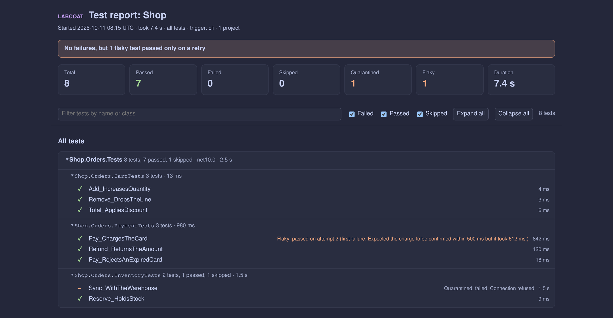
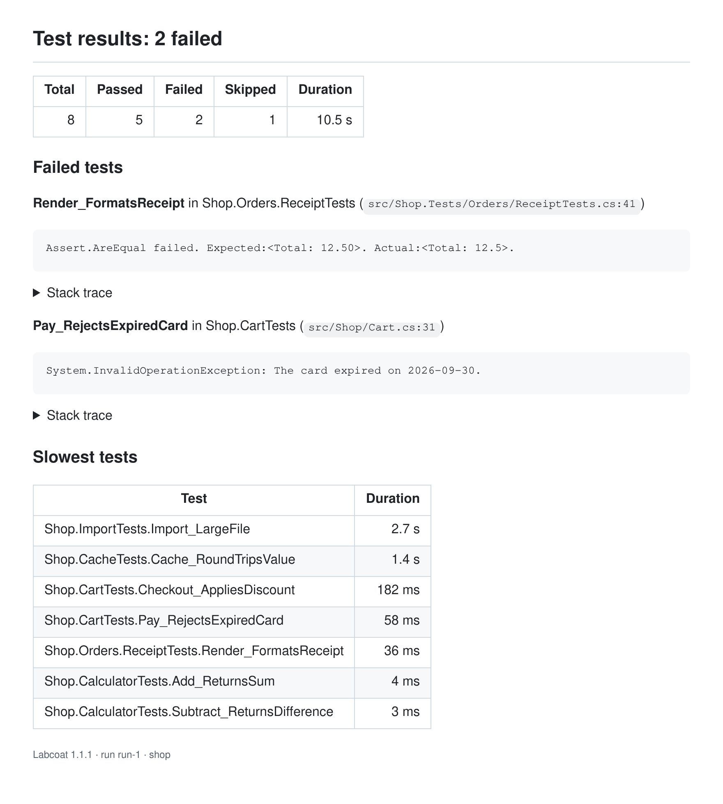

# Running Labcoat without Aspire

Labcoat runs fine on its own: it is a .NET tool (`PackageId` `Labcoat`, command `labcoat`) that serves the UI from the
package and drives your test projects over Microsoft.Testing.Platform's server mode. This page covers the ways to start
it, the command-name decision, and the preview `--labcoat` extension that opens Labcoat from a test project.

## Ways to start it

| How | Command | Install | Notes |
| --- | --- | --- | --- |
| One-shot (.NET 10 SDK) | `dnx Labcoat` | none | Same as `dotnet dnx Labcoat` and `dotnet tool exec Labcoat`. |
| Global tool | `labcoat` | `dotnet tool install -g Labcoat` | Bare command, any directory. |
| Local tool | `dotnet labcoat` | `dotnet new tool-manifest` + `dotnet tool install Labcoat` | Version pinned in `dotnet-tools.json`; `dotnet tool restore` on CI. Also `dotnet tool run labcoat`. |
| From source | `dotnet run --project src/Labcoat -- <paths>` | none | Serves `src/Labcoat/wwwroot` (build the UI first). |
| Inside the test app (preview) | `dotnet run --project MyTests -- --labcoat` | `dotnet add MyTests package Labcoat.TestingPlatform` | See [below](#the---labcoat-extension-preview). |

All of them start the same program. With no paths it picks the workspace itself: the test project in the current
directory, else the nearest `.slnx` (preferred) or `.sln` walking up, stopping at the repository root (`.git`) or the
home directory, else the current directory (scanned recursively). It then prints a banner, opens the browser and builds
and discovers the tests:

```text
   LABCOAT  v1.0.0  test explorer for Microsoft.Testing.Platform

  ➜  Local:     http://localhost:4301
     Port 4300 is in use, using 4301 instead.
  ➜  Workspace: /src/shop/Shop.slnx
  ➜  Tests:     1 test project
                · tests/Shop.Tests/Shop.Tests.csproj

  Press Ctrl+C to stop.
```

- **Port:** 4300 (or `$LABCOAT_DEFAULT_PORT`), else the next free one (20 tries). An explicit `--port`/`$PORT` is used
  as is and is an error when busy (Aspire's proxy and scripts rely on it).
- **Browser:** `$BROWSER`, else `start` / `open` / `xdg-open` (`wslview` on WSL). On Linux the opener runs under
  `setsid`, so a browser that Labcoat starts doesn't receive the terminal's Ctrl+C. Without a display (SSH, containers),
  with `--no-open`, or when `$CI` is set it only prints the URL; a failing opener prints the URL too, never an error.
- **Ctrl+C** stops Labcoat and its warm test hosts (they get MTP's `exit`, so fixtures dispose); exit code 0.

### `dnx` details (verified on SDK 10.0.401)

- `dnx`, `dotnet dnx`, `dotnet tool exec` and `dotnet tool execute` are the same command. `--yes` is accepted (it skips
  the download confirmation; with SDK 10.0.401 no prompt appeared even on a TTY).
- dnx's own options can go before or after the package id: `dnx Labcoat --add-source ./feed` and
  `dnx --add-source ./feed Labcoat` both work. Unknown options (`--port`, `--watch`, `--no-open`, paths) are forwarded
  to Labcoat. dnx keeps `--help`, `-h`, `--version` and `-v` (verbosity) for itself, so use `--` for those:
  `dnx Labcoat -- --help`, `dnx Labcoat -- --version`.
- Pin a version with `dnx Labcoat@1.0.0` (or `--version 1.0.0`); a prerelease (`1.1.0-beta.1`) also needs `--prerelease`.
- The package is cached in the NuGet packages folder by version: a repacked package with the same version isn't picked up
  until `~/.nuget/packages/labcoat/<version>` is removed.
- Inside a directory whose tool manifest lists Labcoat, `dnx Labcoat` runs the manifest's version and restores it from
  the configured sources (`--add-source` is then ignored).

## Command name: `labcoat` or `dotnet labcoat`?

A tool package declares one command name. Measured with both variants:

| | command `labcoat` (current) | command `dotnet-labcoat` |
| --- | --- | --- |
| global install | `labcoat` | `dotnet labcoat` or `dotnet-labcoat` (no bare `labcoat`) |
| local install (manifest) | `dotnet labcoat`, `dotnet tool run labcoat` | `dotnet labcoat`, `dotnet dotnet-labcoat` |
| `dnx Labcoat` | works | works (it uses the package id) |
| `dotnet labcoat` with a global install | "command not found" | works |

**Recommendation: keep `labcoat`.** The `dotnet-` prefix only buys `dotnet labcoat` for *global* installs; local tools
already answer to `dotnet labcoat` either way, and `dnx Labcoat` needs no name at all. In exchange it loses the bare
`labcoat` command, which is shorter and matches how the Aspire docs describe the runner. CSharpier
made the same call when it renamed `dotnet-csharpier` to `csharpier` in 1.0. So the documented spellings are:
`dnx Labcoat` (try it), `dotnet labcoat` (repository-pinned local tool, the recommended team setup) and `labcoat`
(global). If you want `dotnet labcoat` for a global install too, add a link next to the shim:
`ln -s ~/.dotnet/tools/labcoat ~/.dotnet/tools/dotnet-labcoat` (verified on Linux; on Windows a copy of `labcoat.exe` named `dotnet-labcoat.exe` should do the same, not tested).

## The `--labcoat` extension (preview)

`src/Labcoat.TestingPlatform` is a working prototype: reference it from a test project, and the test application gets a
`--labcoat` option that starts Labcoat for **that** project instead of running the tests.

```bash
dotnet add MyApp.Tests package Labcoat.TestingPlatform
dotnet run --project MyApp.Tests -- --labcoat
dotnet run --project MyApp.Tests -- --labcoat watch port=5000 no-open   # Labcoat options, without dashes
dotnet run --project MyApp.Tests -- --help                               # lists --labcoat
```

Settings are Labcoat options without the leading dashes (`watch`, `coverage`, `traces`, `no-open`, `port=<n>`,
`root=<dir>`), because MTP's parser treats any value that starts with `--` as the next option; unknown settings are
rejected by MTP's validation.

### How it works

- **Registration:** the package's `buildTransitive` props add a `TestingPlatformBuilderHook` item, so the MTP generated
  entry point calls `Labcoat.TestingPlatform.TestingPlatformBuilderHook.AddExtensions(builder, args)`. With a
  hand-written entry point, call `builder.AddLabcoat()`.
- **Extension points (public MTP 2.x API):** an `ICommandLineOptionsProvider` declares and validates `--labcoat`; an
  `ITestHostApplicationLifetime` (`BeforeRunAsync`) does the work. Its `IsEnabledAsync` is true only when `--labcoat`
  is set, so normal runs pay nothing.
- **Finding Labcoat:** the package bundles a publish of the runner under `tools/labcoat/` (like
  `Labcoat.Aspire.Hosting`), and its targets record two values in the test app's `runtimeconfig.json` through
  `RuntimeHostConfigurationOption` (`Labcoat.TestingPlatform.ProjectPath` = the `.csproj`,
  `Labcoat.TestingPlatform.LabcoatPath` = the bundled `Labcoat.dll` in the NuGet cache). Nothing is copied to `bin/`.
  Order: `$LABCOAT_PATH` (a `Labcoat.dll` or `labcoat` executable, e.g. a local build) > the bundled runner (MSBuild
  property `LabcoatPath` overrides it) > `dotnet tool exec Labcoat@<package version> --yes`. All three were exercised.
- **Lifetime:** `BeforeRunAsync` starts `dotnet <Labcoat.dll> <project> [settings]` with the console inherited, waits
  for it, then ends the process with Labcoat's exit code (`Environment.Exit`), so no tests run in that process. The
  process tree is `dotnet run` > test app > Labcoat > warm test host. On Ctrl+C the terminal signals the whole group;
  the launcher waits up to 35 s for Labcoat to stop its test hosts, then kills what is left. Verified: all four
  processes gone within a second, `dotnet run` exit code 0.
- **No recursion:** Labcoat starts the same test app with `--server`, and now also sets `LABCOAT_TEST_HOST=1` on every
  test host. The launcher is inert when either is present, and in any `--server` mode (IDE test explorers). Verified:
  with `--labcoat` the tree stays at one Labcoat, and `LABCOAT_TEST_HOST=1 dotnet run -- --labcoat` just runs the tests.
- **`dotnet test`:** on .NET 10 an MTP project must use the new MTP mode (`global.json`:
  `{"test": {"runner": "Microsoft.Testing.Platform"}}`); the VSTest mode now fails with "Testing with VSTest target is
  no longer supported". MTP mode forwards unknown options (`dotnet test --project MyTests --labcoat`, no `--` needed) but
  starts the app with `--server dotnettestcli` and owns its output, possibly for several projects at once. The extension
  rejects that combination with a clear message instead of silently running the tests:
  `--labcoat isn't supported under 'dotnet test'. Use 'dotnet run --project <test project> -- --labcoat', or 'dnx Labcoat'.`

### Options that were considered

| Option | Verdict |
| --- | --- |
| Raw `args` check in the builder hook + `Environment.Exit` | Works, but bypasses MTP's parsing, `--help` and validation. |
| `ICommandLineOptionsProvider` + `ITestHostApplicationLifetime` | **Chosen**: public API, listed in `--help`, validated, inert unless asked. |
| Test host orchestrator (what `--retry-failed-tests` uses) | The natural fit, but `ITestHostOrchestratorExtension` is internal in MTP 2.0.2. |
| Test host controller (`ITestHostProcessLifetimeHandler`) | Forces MTP's out-of-process controller mode on every run; heavier for no gain. |
| Reference the Labcoat assembly and host it in-process | Drags ASP.NET Core and Labcoat's dependencies into the test app; and Labcoat must rebuild and restart that very app. Rejected. |
| Bundle the runner (chosen) vs `dotnet tool exec` only | Bundling works offline and keeps runner and extension in lockstep (about 1 MB in the NuGet cache, nothing in `bin/`); `dotnet tool exec` stays as the fallback. |

### Limitations

- **Windows (not tested; expected issue):** the test app process stays alive while Labcoat runs, and Windows locks its
  `.exe`/`.dll`. A no-op build is fine (MSBuild skips the copy), but after a source edit Labcoat's rebuild of that
  project will fail to overwrite the output (MSB3027). Fix candidates: let Labcoat build into its own output directory
  (also removes the existing "stop the warm host before building" workaround on Windows), or make the launcher exit
  right after Labcoat is up (worse Ctrl+C and console behaviour). On Linux this works as is (verified); macOS is
  expected to behave like Linux.
- Requires Microsoft.Testing.Platform 2.x (MSTest 4, xUnit v3 3.x, NUnit 4.4+ with NUnit3TestAdapter 6, TUnit; MTP 1.x
  named the lifetime interface differently) and the .NET 10 runtime for Labcoat itself; the test project may target net8.0 or later.
- The bundled runner path is absolute (the NuGet cache): copying `bin/` to another machine falls back to
  `dotnet tool exec`.
- One project per invocation (the one you `dotnet run`); for a whole solution use `dnx Labcoat` / `dotnet labcoat`.
- An IDE "Run" of the test project with `--labcoat` in its launch profile should behave like `dotnet run` (not tested);
  IDE test explorers never pass it (and use `--server`, where the launcher is inert).

## Labcoat in CI

`--run` runs Labcoat once without the UI: it builds and discovers the test projects, runs every test (or the
`--filter`ed ones), writes the reports you ask for with `--export` and exits. No web server, no browser.

```sh
dotnet labcoat --run --export junit=out/results.xml --export html=out/report.html --export lcov=out/coverage.info MyApp.slnx
```

| Exit code | Meaning |
| --- | --- |
| `0` | No test failed (skipped tests, failures of [quarantined](features.md#history-flaky-tests-and-past-runs) tests and failures that passed on a [`--retry-failed`](#flaky-tests-and-the-quarantine-file) retry don't count), or `--affected` found no affected test. |
| `1` | A test failed or timed out, a test took longer than `--max-test-duration`, the run was aborted (a test host crashed) or cancelled, `--filter` matched nothing, a report or the `--build-impact-map` file could not be written, or a coverage threshold was missed or could not be checked. |
| `2` | A project did not build or discover, nothing could run, git could not answer for `--affected` (not a repository, unknown ref, no base branch), or the command line is invalid. |

| Option | |
| --- | --- |
| `--export junit=<file>` | JUnit XML: one `testsuite` per test project, one `testcase` per test (data rows by their display name) with `classname` = `Namespace.Class`, `failure` for assertion failures, `error` for unexpected exceptions, timeouts and crashed test hosts, `skipped` (also not run, cancelled and quarantined failures), `flakyFailure` / `flakyError` (a test that passed on a retry) and `rerunFailure` / `rerunError` (a retry that failed again), capped `system-out` / `system-err`, and `properties` (Labcoat version, run id, trigger, target framework). Valid against the Jenkins / Surefire `junit-10.xsd`; read by Azure Pipelines `PublishTestResults` (`JUnit`), GitLab and Jenkins. |
| `--export html=<file>` | A single static HTML file: summary, the failed tests first (message, expected / actual diff, stack trace, output), then every project and class with durations, and filters. No external requests (its Content-Security-Policy allows nothing else); every test name and output is escaped. Light and dark follow the system. For 20,000 tests passed tests are one line each and details are kept for the first 500 failures. |
| `--export markdown=<file>` | The run as GitHub-flavored Markdown, sized for a pull request comment (under 60 KB): the verdict and totals, the failed tests first (message, source location, stack trace folded away), the flaky tests of a `--retry-failed` run, the ten slowest tests. Test names and output are escaped, so they cannot inject markup or mention a user. When it does not fit, the remaining failed tests are counted in a note. |
| `--export trx=<file>` | A VSTest TRX file (`TestRun`, `Results`, `TestDefinitions`, `TestEntries`, `ResultSummary` with counters) that Visual Studio and Azure Pipelines (`PublishTestResults@2`, `testResultsFormat: VSTest`) read. Passed, Failed, Timeout and NotExecuted (skipped, not run, cancelled, quarantined failures); a test that passed on a `--retry-failed` retry is Passed, with its failed attempts as text messages. The result ids are the same for the same run. |
| `--export sarif=<file>` | The failures as SARIF 2.1.0 for code scanning (`github/codeql-action/upload-sarif`, the Azure DevOps and VS Code SARIF viewers): one result per failed test with its message and the file and line of the assertion (else the test, else the project file), relative to the workspace root. Quarantined failures are `note`s, tests that passed on a `--retry-failed` retry `warning`s with their first failure; other passed and skipped tests are not results. |
| `--export lcov=<file>` | This run's coverage as `lcov.info` (`SF`, `DA`, `BRDA`, `BRF` / `BRH`, `LF` / `LH`, `end_of_record`) for Codecov, Coveralls, SonarQube or `genhtml`. Collects coverage like `--coverage`. |
| `--export cobertura=<file>` | The same coverage as Cobertura XML (ReportGenerator, Azure Pipelines, GitLab); a comment at the top names the coverage settings used per project. |
| `--order random` | Run the tests one at a time in a random order, to find tests that depend on each other (fixtures run again for each test). Random-order runs do not collect coverage, so `--order random` together with `--coverage`, `--min-coverage`, `--min-diff-coverage` or an lcov / cobertura `--export` is an error (exit code 2). The seed is printed first and written to the JUnit (`labcoat.randomSeed`) and HTML reports. |
| `--seed <n>` | With `--order random`: the seed of an earlier run, to run the same order again. Without it a new seed is chosen. |
| `--export-paths absolute` | Absolute source paths in lcov / Cobertura. The default writes them relative to the workspace root: the git repository root, else the common folder of the inputs and the test projects (and what they reference); files outside it stay absolute. |
| `--min-coverage <percent>` | Fails the run (exit code 1) when the line coverage of this run is below the percentage (0-100). Collects coverage like `--coverage`; with `--filter` the coverage is that of the filtered tests. Refused with `--affected`. |
| `--min-diff-coverage <percent>` | Fails the run (exit code 1) when the lines changed versus the base are covered less than the percentage. The base is the merge base with `--affected-base` (else `origin/HEAD`, `origin/main`, `main` or `master`), plus uncommitted and untracked files, as in "Run affected"; with `--affected` it is the changes that selected the tests. The changed lines come from `git diff` and only the executable ones count. Collects coverage like `--coverage`. |
| `--affected [base]` | Only the tests the changes in git affect, with an optional `--impact-map-file` from a job on main. See [Running only the affected tests in CI](#running-only-the-affected-tests-in-ci). |
| `--max-test-duration <duration>` | A budget per test: tests that took longer are listed and fail the run (exit code `1`), quarantined tests excepted. Nothing is cancelled, unlike `--test-timeout`. Also `maxTestDuration` in the settings file ([Duration budget](configuration.md#duration-budget)). |
| `--retry-failed <n>` | After the run, rerun only the tests that failed, up to `n` times (1 to 10). See [Flaky tests](#flaky-tests-and-the-quarantine-file). |
| `--quarantine-file <file>` | A committed list of quarantined tests by name. See [Flaky tests](#flaky-tests-and-the-quarantine-file). |
| `--filter <pattern>` | Only tests whose display name, `Namespace.Class(.Method)` or project contains the pattern; `*` is a wildcard over the whole name (`*CartTests.Pay*`). Comma-separated; repeatable. |

The thresholds print their result and, for the diff, the lines that lack coverage:

```
  Coverage: ok 84.2% of lines (1263/1500), minimum 80%
  Diff coverage: below 66.6% of changed lines (10/15), minimum 80% (changes vs origin/main (a1b2c3d))
    src/Shop/Cart.cs: lines 41-44, 60 not covered (3/7)
```

They need coverage: when none was collected (no test project references `Microsoft.Testing.Extensions.CodeCoverage`),
or no base can be found for `--min-diff-coverage` (not a repository, no `main` / `master` and no `--affected-base`; in a
shallow clone fetch the base branch first), the run fails with exit code 1 and says why. A build error (exit code 2)
takes precedence. A change without executable lines (documentation, comments, files outside the coverage settings)
passes `--min-diff-coverage`; lines next to a removed block count as changed.

Coverage counts what the [coverage settings](features.md#which-code-counts) count: the project's settings file, or
Labcoat's defaults (product code only). The console output and the Cobertura comment say which applied. Results also go
to the workspace's history like any run (`LABCOAT_HISTORY_DIR`), so a run on a developer machine shows up in the UI's
run list (trigger "CLI").

The same files can be downloaded from a running Labcoat: the **Export** items of the run menu in the header, the command
palette ("Export run as JUnit XML / HTML report / Markdown / TRX / SARIF", "Export coverage as lcov") and the **Export**
button of the Coverage page, or the REST API (`GET /api/runs/{runId}/export?format=junit|html|markdown|trx|sarif`,
`GET /api/coverage/export?format=lcov|cobertura`, see [contract.md](contract.md#export-added)).

### Sharding

`--shard <i>/<n>` runs shard *i* of *n* (1-based) of the tests, so a matrix of CI jobs can run one suite in parallel. Every shard builds and
discovers all test projects, works out the same split on its own and runs only its part.

| Option | |
| --- | --- |
| `--shard <i>/<n>` | Run this shard. A shard without tests (more shards than classes) writes empty reports and exits `0`. Applies after `--filter`. |
| `--shard-by class\|test\|project` | What is split. `class` (default) keeps a class together, so a class fixture or a started app runs once; `test` splits finer for a suite with a few huge classes; `project` keeps whole projects together. |
| `--shard-timings <file>` | The JUnit XML of an earlier run (`--export junit`) that balances the shards by duration. Repeatable and comma-separated; a name with `*` or `?` in its last segment (`timings/*/results.xml`) matches several files. A named file that does not exist is an error; a pattern that matches nothing is a warning and the tests are dealt out by name. |

Without timings the classes are sorted by name and dealt out one by one: even in count, not in duration. With timings the
longest class goes first to the shard with the least work so far, and a class without a timing counts as the median one.

Every shard must see the same test list and the same timing files: that is what makes the shards add up to the whole
suite. Labcoat's own history is therefore not used, as it differs per machine. Each shard prints a split id
(`split 9f3a1c`); when the ids of the shards differ, they did not see the same input. The reports of the shards are
separate: publish one JUnit file per shard (or merge them), and merge the lcov files before a coverage service reads them.

```yaml
jobs:
  test:
    runs-on: ubuntu-latest
    strategy:
      fail-fast: false
      matrix:
        shard: [1, 2, 3, 4]
    steps:
      - uses: actions/checkout@v4
      - uses: actions/setup-dotnet@v4
        with:
          dotnet-version: 10.0.x
      - run: dotnet tool restore
      - name: Test
        run: >
          dotnet labcoat --run MyApp.slnx
          --shard ${{ matrix.shard }}/4
          --shard-timings "timings/*.xml"
          --export junit=out/results-${{ matrix.shard }}.xml
      - uses: actions/upload-artifact@v4
        if: ${{ !cancelled() }}
        with:
          name: junit-${{ matrix.shard }}
          path: out/results-${{ matrix.shard }}.xml
```

Download the JUnit artifacts of the last green run into `timings/` in every job (for example with `actions/cache` or
`gh run download`) to get balanced shards.

### Flaky tests and the quarantine file

`--retry-failed <n>` reruns the failed tests after the run, up to `n` times, each round only the tests that are still
failing. Labcoat does this itself, with ordinary runs of just those tests (they show up in the run list with the trigger
"cli-retry"); the Microsoft.Testing.Platform `--retry-failed-tests` extension is not used (see
[Options that were considered](#options-that-were-considered)).

- A test that fails and then passes is **flaky**: it counts as passed, the run does not fail because of it, and it is
  flagged: the console says `Flaky: Name failed 1 time and passed on attempt 2` and the summary line counts it, the JUnit
  file has a `flakyFailure` (or `flakyError`) per failed attempt on the passed `testcase` plus a `labcoat.flaky`
  property per project, and the HTML report shows a **Flaky** card, a warning banner when nothing else failed and a
  note on the test's row. The Markdown report and the step summary count it in a **Flaky** column and list it under
  "Flaky tests", TRX keeps it Passed with its failed attempts as text messages, SARIF reports it as a `warning` and the
  GitHub Actions annotations as a `::warning` at its first failure.
- A test that never passes stays failed (exit code `1`). Its first failure is the `failure` element, the failures of the
  retries are `rerunFailure` / `rerunError`; the other reports say "Failed all n attempts".
- Quarantined tests are not retried. Nothing is retried when the run was cancelled, aborted or a project did not build.
- The retries start the test hosts again; coverage comes from the first run only, so `--min-coverage` and
  `--min-diff-coverage` judge the first run. `--max-test-duration` judges the attempt that counts: a flaky test by the
  attempt that passed.
- `--retry-failed` and `--order random` can't be combined (exit code 2): a retry runs the failed tests on their own, so a
  test that fails only in the random order would pass and be reported as flaky.



`--quarantine-file <file>` (or `"quarantineFile"` in [.labcoat.json](configuration.md#settings-files); a relative path
there is relative to that file) names a text file you keep in the repository, so the whole team and CI quarantine the
same tests:

```text
# Known flaky, tracked in #1234
Shop.Orders.OrderTests.Places_order
Shop.Math.CalculatorTests.Multiply (2,3,7)
Shop.Slow.*
Shop.Legacy.LegacyTests
```

One name per line: `Namespace.Class.Method` (every data row), `Namespace.Class.Display name (1,2)` (one data row),
`Namespace.Class` (every test of the class), whole names matched case-insensitively, `*` as a wildcard; empty lines and
lines starting with `#` are ignored. Listed tests behave as the ones quarantined in the UI: they still run, are counted
separately and a failure does not fail the run. The file is added to the tests quarantined in the UI, never merged into
it: Labcoat only reads the file, so the UI cannot release a test the file lists (it says which file to edit), and
quarantining a test in the UI never rewrites your file. A file that does not exist is an error (exit code `2`), because
ignoring it would let quarantined tests fail the build.

### GitHub Actions

```yaml
jobs:
  test:
    runs-on: ubuntu-latest
    permissions:
      contents: read
    steps:
      - uses: actions/checkout@v4
      - uses: actions/setup-dotnet@v4
        with:
          dotnet-version: 10.0.x
      - run: dotnet tool restore   # Labcoat as a local tool (dotnet-tools.json)
      - name: Test
        run: >
          dotnet labcoat --run MyApp.slnx
          --export junit=out/results.xml
          --export html=out/report.html
          --export lcov=out/coverage.info
      - name: Test report (HTML)
        if: ${{ !cancelled() }}
        uses: actions/upload-artifact@v4
        with:
          name: labcoat-report
          path: out/report.html
```

`if: ${{ !cancelled() }}` keeps the reports when tests failed (the Test step then fails with exit code 1). On Azure
Pipelines publish the same file with `PublishTestResults@2` (`testResultsFormat: JUnit`, `testResultsFiles:
out/results.xml`) and the coverage with `PublishCodeCoverageResults@2` (`summaryFileLocation: out/coverage.xml` from
`--export cobertura=out/coverage.xml`).

### Step summary and annotations

Under GitHub Actions `--run` reports to the workflow by itself; there is nothing to enable:

- When `$GITHUB_STEP_SUMMARY` is set, it appends the Markdown report (totals, the failed tests first with message and
  stack trace, the flaky tests, the slowest tests, and the coverage when it was collected) to the job summary. The text
  is cut to fit GitHub's 1 MiB limit, with a note counting the failed tests left out.
- When `GITHUB_ACTIONS=true`, every failed test becomes an `::error file=…,line=…,title=…::message` annotation at the
  line of its assertion, so it shows in the pull request's **Files changed**; a test that passed on a `--retry-failed`
  retry becomes a `::warning` at its first failure. At most 50 are written (errors first), followed by a `::notice`
  that counts the rest. Characters the workflow-command syntax reserves (`%`, line breaks, and `:` / `,` in the file
  and title) are escaped. Quarantined failures (also those of `--quarantine-file`) are not annotated.
- Both describe the run with its `--retry-failed` retries applied, like the `--export` files. They report the test
  results only: a run that fails because of `--min-coverage`, `--min-diff-coverage` or `--max-test-duration` says why
  in the log, and its exit code is `1` even when the summary has no failed tests.



```yaml
jobs:
  test:
    runs-on: ubuntu-latest
    permissions:
      contents: read
      security-events: write   # only for the SARIF upload
    steps:
      - uses: actions/checkout@v4
      - uses: actions/setup-dotnet@v4
        with:
          dotnet-version: 10.0.x
      - run: dotnet tool restore
      - name: Test
        run: >
          dotnet labcoat --run MyApp.slnx
          --export markdown=out/summary.md
          --export sarif=out/tests.sarif
          --export lcov=out/coverage.info
      - uses: github/codeql-action/upload-sarif@v3
        if: ${{ !cancelled() }}
        with:
          sarif_file: out/tests.sarif
          category: labcoat-tests
```

The job summary and the annotations come from the Test step; `--export markdown` is the same text as a file, for a
pull request comment (post `out/summary.md` with `gh pr comment --body-file`) or any other place that renders Markdown.
Azure Pipelines and Visual Studio read the TRX file (`--export trx=out/results.trx`).

### Merging shard reports

When the tests of a run are split over several jobs (each job runs part of them with `--run --filter ...`), each job
writes its own report files. `labcoat merge` combines them into one set, in a last job that builds nothing and runs
nothing:

```sh
dotnet labcoat merge --export junit=out/results.xml --export lcov=out/coverage.info --export cobertura=out/coverage.xml \
  shards/results-*.xml shards/coverage-*.info
```

| Exit code | Meaning |
| --- | --- |
| `0` | No merged test failed or errored. |
| `1` | A merged test failed or errored, or a report could not be written. |
| `2` | The command line is invalid, or an input is missing or unreadable (nothing is written). |

- **Inputs:** JUnit XML, lcov and Cobertura files, told apart by their content, not their name. Pass the paths (a
  list your shell expanded) or a pattern with `*` / `?` in the file name part, for shells that don't expand it
  (`shards/results-*.xml`; the folders cannot have wildcards, and a pattern never matches the files being written). A
  named file that doesn't exist, a pattern that matches nothing and a file that is not one of these reports are errors.
- **`--export junit=<file>`:** the suites of all inputs; a suite of the same name in several inputs becomes one. A
  test that appears twice (same suite, `classname` and `name`, e.g. a shard that was run again) keeps the last one and
  prints a warning. The totals are recomputed from the test cases. The first suite's properties are kept, plus
  `labcoat.mergedFrom` (how many reports the suite came from). The file is valid against the same `junit-10.xsd` as
  `--run`'s.
- **`--export lcov=<file>` / `--export cobertura=<file>`:** the union of the source files of all lcov and Cobertura
  inputs (they can be mixed, and either format can be written). Files are matched by their path as written, so every
  shard should write the same relative paths (Labcoat's default). Per file the hit counts of each line and branch are
  summed, and the line and branch totals and rates are recomputed. Cobertura only has branch counts per line, so its
  branches are taken as the first ones of the line. Function records of lcov (`FN`, `FNDA`) and Cobertura `methods`
  are not kept.
- **Summary:** the console shows the merged tests (failed, passed, skipped) and, when there is coverage, the line and
  branch percentages. A coverage gate can build on the same totals later; `merge` does not enforce a threshold.

A GitHub Actions merge job. Each test job uploads its report files (`results-1.xml`, `coverage-1.info`, ... with
unique names) as the artifact `shard-<n>`:

```yaml
  merge:
    needs: test                # the matrix job that runs one shard per job and uploads its reports
    if: ${{ !cancelled() }}    # also when a shard failed
    runs-on: ubuntu-latest
    steps:
      - uses: actions/checkout@v4
      - uses: actions/setup-dotnet@v4
        with:
          dotnet-version: 10.0.x
      - run: dotnet tool restore
      - uses: actions/download-artifact@v4
        with:
          pattern: shard-*
          path: shards
          merge-multiple: true      # all files into shards/
      - name: Merge
        run: >
          dotnet labcoat merge
          --export junit=out/results.xml
          --export lcov=out/coverage.info
          --export cobertura=out/coverage.xml
          "shards/results-*.xml" "shards/coverage-*.info"
      - uses: actions/upload-artifact@v4
        if: ${{ !cancelled() }}
        with:
          name: merged-reports
          path: out/
```

The Merge step fails (exit code 1) when a merged test failed, so the job is red like an unsplit run. Quote the
patterns so the runner passes them on instead of expanding them (or leave them unquoted: both work).

### Running only the affected tests in CI

`--affected [working|branch|<range>]` runs only the tests the changes in git affect, with the same bases as **Run
affected** in the UI ([features.md](features.md#run-affected-tests)): `working` is the uncommitted changes, `branch`
(the default) everything since the branch left its base branch (`--affected-base`, default `origin/HEAD`, else
`origin/main` / `master`), and a commit range such as `origin/main..HEAD` (`--affected=<ref>` for one commit).

```sh
dotnet labcoat --run --affected --export junit=out/results.xml MyApp.slnx
```

Labcoat prints the plan before it runs: the changed files, the tests each one selects and how precise that is. The
selected tests then run like any `--run` (`--filter` narrows them further: only tests matching both run).

```
  Affected (branch vs origin/main, merge base 4f2a9c1): 2 changed files -> 6 of 17 tests in 1 project
    SampleTests.Lib/Calculator.cs: impact map (class-level data, method Subtract) -> 6 tests
    README.md: not code, no tests
```

When nothing is affected Labcoat says so, writes the `--export` files (zero tests, empty coverage) and exits `0`. A
base git cannot answer (not a repository, unknown ref, no base branch) exits `2`; the other exit codes are the ones of
`--run`.

With the other `--run` options:

- `--shard i/n` splits the affected tests, not all of them: every shard job makes the same plan (same commit, same
  map file) and runs its part. A shard without affected tests exits `0`.
- `--min-diff-coverage` checks the lines of the changes the plan was made of (with `--affected working` the
  uncommitted ones, with a range the range's). `--min-coverage` is refused with `--affected`: only part of the suite
  runs, so its overall coverage is not the suite's.
- `--retry-failed`, `--order random`, `--max-test-duration`, the `--export` files and the GitHub Actions summary work as
  for any `--run`, on the affected tests.

Without more, a changed **test file** selects exactly its tests, but a changed **product file** selects all tests of
the projects that contain or reference it: a fresh CI runner has no [impact map](features.md#the-impact-map). To make
product files precise, build the map on your main branch, keep it as a file and give it to the pull request jobs:

| Option | |
| --- | --- |
| `--impact-map-file <file>` | With `--affected`: the map to load before planning. With `--build-impact-map`: where to save it (atomically; a `.gz` file is compressed). A missing file is fine (the first run, or a cache miss: project-level precision), an unusable one is ignored with a warning. |
| `--build-impact-map` | Runs the impact-map pass after the run (`--impact-map class`, the default: one coverage run per test class; `--impact-map test`: one per test, exact but slower) and saves the map. Together with `--affected` it builds the map for the projects that need it before planning. Not with `--shard`: build the map in one job. |

```yaml
# .github/workflows/impact-map.yml: on main, on every push and nightly
name: impact-map
on:
  push:
    branches: [main]
  schedule:
    - cron: "0 3 * * *"
jobs:
  impact-map:
    runs-on: ubuntu-latest
    steps:
      - uses: actions/checkout@v4
      - uses: actions/setup-dotnet@v4
        with:
          dotnet-version: 10.0.x
      - run: dotnet tool restore
      - name: Test and build the impact map
        run: dotnet labcoat --run MyApp.slnx --build-impact-map --impact-map-file impact.json
      - uses: actions/cache/save@v4
        if: ${{ !cancelled() }}      # failing tests must not lose the map
        with:
          path: impact.json
          key: impact-map-${{ github.sha }}
```

```yaml
# .github/workflows/pull-request.yml
name: pull-request
on: pull_request
jobs:
  affected-tests:
    runs-on: ubuntu-latest
    steps:
      - uses: actions/checkout@v4
        with:
          fetch-depth: 0             # the merge base with the base branch needs the history
      - uses: actions/setup-dotnet@v4
        with:
          dotnet-version: 10.0.x
      - run: dotnet tool restore
      - uses: actions/cache/restore@v4
        with:
          path: impact.json
          key: impact-map-none       # never hits: restore-keys takes the newest map of main
          restore-keys: impact-map-
      - name: Affected tests
        run: >
          dotnet labcoat --run MyApp.slnx --affected branch --affected-base origin/main
          --impact-map-file impact.json --export junit=out/results.xml
```

Caches written on the default branch can be restored by pull request jobs, which is what makes this work.

**What the map file holds.** A small versioned JSON file (`"format": "labcoat-impact-map"`, `"version": 1`; a file of a
newer version than the running Labcoat reads is ignored with a warning). It is keyed on stable names, never on test ids
or absolute paths, so a map built on one machine fits another checkout:

| Key | |
| --- | --- |
| `labcoat`, `builtAt`, `commit`, `mode` | Who built it, when, at which commit and with which `--impact-map` granularity. |
| `files`, `hashes` | The source files that tests executed, relative to the repository root with `/` separators, and a hash of each file's text (line endings ignored) when the coverage was recorded. |
| `names`, `spans`, `profiles` | The executed methods as (file, first line, last line, name), and the list of methods per profile. Tests that executed the same methods share a profile, so a class-level map of 20,000 tests in 1,000 classes is about 1 MB and a per-test map of 20,000 tests about 3 MB (synthetic suites of 40 methods per test). |
| `projects` | Per test project (path relative to the repository root), its classes and for each test: method, display name (when it differs), profile and whether the data is exact (per-test) or shared by its class. |

When it is loaded, entries are matched to the discovered tests by project path, `Namespace.Class`, method and display
name; entries of tests or projects that no longer exist are ignored, and a data row whose display name changed shares
the data of its method. The map may be older than the branch, and Labcoat makes up for that:

- a changed file whose text at the merge base differs from the text the map was recorded with (it changed on main after
  the map was built, so the map's line numbers no longer fit) is handled like a file without impact data: all tests of
  its projects, with a warning;
- tests the map has no data for (added after it was built) run whenever a changed product file selects tests of their
  project;
- what the pull request itself changes is, by definition, in the diff.

**Limits.**

- Precision is as good as the data: with `--impact-map class` (the default) changing `Calculator.Subtract` selects all
  of `CalculatorTests` (6 of the sample's 17 tests); `--impact-map test` on the main job selects only the tests that run
  the changed method, at the price of one coverage process per test when the map is built. The UI refines classes per
  test in the background; `--run --affected` does not start coverage processes next to the run.
- Without a map file, or for a product file no test in the map executed (a new file, code that only runs at startup, a
  project without `Microsoft.Testing.Extensions.CodeCoverage`), a changed product file selects all tests of the projects
  that contain or reference it. Changes that tests reach without executing C# (configuration, embedded resources,
  generated code) are only seen through the project they belong to.
- The map is as old as its last build: a pull request that touches code which main changed after the map was built gets
  the project-level fallback for exactly those files.
- Building the map costs a coverage process per class (or test) on top of the normal run, about the numbers in
  [The impact map](features.md#the-impact-map). That is why it belongs on main, nightly or on push, and not on every
  pull request.

## Recommended setup

1. **Trying it:** `dnx Labcoat` in the repository.
2. **Teams:** a local tool, so everyone and CI get the same version:
   `dotnet new tool-manifest && dotnet tool install Labcoat`, then `dotnet labcoat`.
3. **Personal machine:** `dotnet tool install -g Labcoat`, then `labcoat` anywhere.
4. **Per test project (preview):** `Labcoat.TestingPlatform` and `dotnet run -- --labcoat`.
5. **With Aspire:** `Labcoat.Aspire.Hosting` (see [aspire.md](aspire.md)).

All options and environment variables: [configuration.md](configuration.md).
