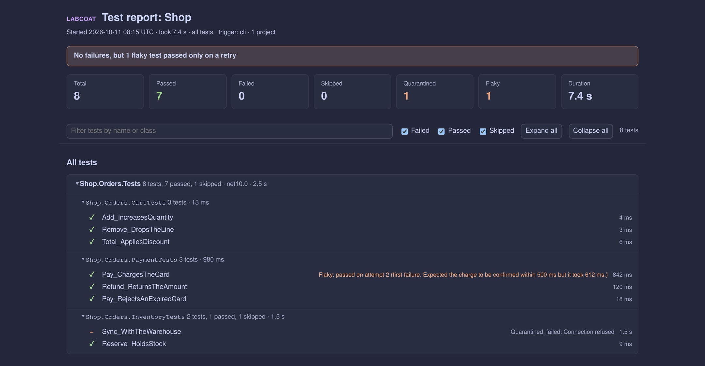

# Running Labcoat without Aspire

Labcoat runs fine on its own: it is a .NET tool (`PackageId` `Labcoat`, command `labcoat`) that serves the UI from the
package and drives your test projects over Microsoft.Testing.Platform's server mode. This page covers the ways to start
it, the command-name decision, and the preview `--labcoat` extension that opens Labcoat from a test project.

## Ways to start it

| How | Command | Install | Notes |
| --- | --- | --- | --- |
| One-shot (.NET 10 SDK) | `dnx Labcoat` | none | Same as `dotnet dnx Labcoat` and `dotnet tool exec Labcoat`. |
| Global tool | `labcoat` | `dotnet tool install -g Labcoat` | Bare command, any directory. |
| Local tool | `dotnet labcoat` | `dotnet new tool-manifest` + `dotnet tool install Labcoat` | Version pinned in `dotnet-tools.json`; `dotnet tool restore` on CI. Also `dotnet tool run labcoat`. |
| From source | `dotnet run --project src/Labcoat -- <paths>` | none | Serves `src/Labcoat/wwwroot` (build the UI first). |
| Inside the test app (preview) | `dotnet run --project MyTests -- --labcoat` | `dotnet add MyTests package Labcoat.TestingPlatform` | See [below](#the---labcoat-extension-preview). |

All of them start the same program. With no paths it picks the workspace itself: the test project in the current
directory, else the nearest `.slnx` (preferred) or `.sln` walking up, stopping at the repository root (`.git`) or the
home directory, else the current directory (scanned recursively). It then prints a banner, opens the browser and builds
and discovers the tests:

```text
   LABCOAT  v1.0.0  test explorer for Microsoft.Testing.Platform

  ➜  Local:     http://localhost:4301
     Port 4300 is in use, using 4301 instead.
  ➜  Workspace: /src/shop/Shop.slnx
  ➜  Tests:     1 test project
                · tests/Shop.Tests/Shop.Tests.csproj

  Press Ctrl+C to stop.
```

- **Port:** 4300 (or `$LABCOAT_DEFAULT_PORT`), else the next free one (20 tries). An explicit `--port`/`$PORT` is used
  as is and is an error when busy (Aspire's proxy and scripts rely on it).
- **Browser:** `$BROWSER`, else `start` / `open` / `xdg-open` (`wslview` on WSL). On Linux the opener runs under
  `setsid`, so a browser that Labcoat starts doesn't receive the terminal's Ctrl+C. Without a display (SSH, containers),
  with `--no-open`, or when `$CI` is set it only prints the URL; a failing opener prints the URL too, never an error.
- **Ctrl+C** stops Labcoat and its warm test hosts (they get MTP's `exit`, so fixtures dispose); exit code 0.

### `dnx` details (verified on SDK 10.0.401)

- `dnx`, `dotnet dnx`, `dotnet tool exec` and `dotnet tool execute` are the same command. `--yes` is accepted (it skips
  the download confirmation; with SDK 10.0.401 no prompt appeared even on a TTY).
- dnx's own options can go before or after the package id: `dnx Labcoat --add-source ./feed` and
  `dnx --add-source ./feed Labcoat` both work. Unknown options (`--port`, `--watch`, `--no-open`, paths) are forwarded
  to Labcoat. dnx keeps `--help`, `-h`, `--version` and `-v` (verbosity) for itself, so use `--` for those:
  `dnx Labcoat -- --help`, `dnx Labcoat -- --version`.
- Pin a version with `dnx Labcoat@1.0.0` (or `--version 1.0.0`); a prerelease (`1.1.0-beta.1`) also needs `--prerelease`.
- The package is cached in the NuGet packages folder by version: a repacked package with the same version isn't picked up
  until `~/.nuget/packages/labcoat/<version>` is removed.
- Inside a directory whose tool manifest lists Labcoat, `dnx Labcoat` runs the manifest's version and restores it from
  the configured sources (`--add-source` is then ignored).

## Command name: `labcoat` or `dotnet labcoat`?

A tool package declares one command name. Measured with both variants:

| | command `labcoat` (current) | command `dotnet-labcoat` |
| --- | --- | --- |
| global install | `labcoat` | `dotnet labcoat` or `dotnet-labcoat` (no bare `labcoat`) |
| local install (manifest) | `dotnet labcoat`, `dotnet tool run labcoat` | `dotnet labcoat`, `dotnet dotnet-labcoat` |
| `dnx Labcoat` | works | works (it uses the package id) |
| `dotnet labcoat` with a global install | "command not found" | works |

**Recommendation: keep `labcoat`.** The `dotnet-` prefix only buys `dotnet labcoat` for *global* installs; local tools
already answer to `dotnet labcoat` either way, and `dnx Labcoat` needs no name at all. In exchange it loses the bare
`labcoat` command, which is shorter and matches how the Aspire docs describe the runner. CSharpier
made the same call when it renamed `dotnet-csharpier` to `csharpier` in 1.0. So the documented spellings are:
`dnx Labcoat` (try it), `dotnet labcoat` (repository-pinned local tool, the recommended team setup) and `labcoat`
(global). If you want `dotnet labcoat` for a global install too, add a link next to the shim:
`ln -s ~/.dotnet/tools/labcoat ~/.dotnet/tools/dotnet-labcoat` (verified on Linux; on Windows a copy of `labcoat.exe` named `dotnet-labcoat.exe` should do the same, not tested).

## The `--labcoat` extension (preview)

`src/Labcoat.TestingPlatform` is a working prototype: reference it from a test project, and the test application gets a
`--labcoat` option that starts Labcoat for **that** project instead of running the tests.

```bash
dotnet add MyApp.Tests package Labcoat.TestingPlatform
dotnet run --project MyApp.Tests -- --labcoat
dotnet run --project MyApp.Tests -- --labcoat watch port=5000 no-open   # Labcoat options, without dashes
dotnet run --project MyApp.Tests -- --help                               # lists --labcoat
```

Settings are Labcoat options without the leading dashes (`watch`, `coverage`, `traces`, `no-open`, `port=<n>`,
`root=<dir>`), because MTP's parser treats any value that starts with `--` as the next option; unknown settings are
rejected by MTP's validation.

### How it works

- **Registration:** the package's `buildTransitive` props add a `TestingPlatformBuilderHook` item, so the MTP generated
  entry point calls `Labcoat.TestingPlatform.TestingPlatformBuilderHook.AddExtensions(builder, args)`. With a
  hand-written entry point, call `builder.AddLabcoat()`.
- **Extension points (public MTP 2.x API):** an `ICommandLineOptionsProvider` declares and validates `--labcoat`; an
  `ITestHostApplicationLifetime` (`BeforeRunAsync`) does the work. Its `IsEnabledAsync` is true only when `--labcoat`
  is set, so normal runs pay nothing.
- **Finding Labcoat:** the package bundles a publish of the runner under `tools/labcoat/` (like
  `Labcoat.Aspire.Hosting`), and its targets record two values in the test app's `runtimeconfig.json` through
  `RuntimeHostConfigurationOption` (`Labcoat.TestingPlatform.ProjectPath` = the `.csproj`,
  `Labcoat.TestingPlatform.LabcoatPath` = the bundled `Labcoat.dll` in the NuGet cache). Nothing is copied to `bin/`.
  Order: `$LABCOAT_PATH` (a `Labcoat.dll` or `labcoat` executable, e.g. a local build) > the bundled runner (MSBuild
  property `LabcoatPath` overrides it) > `dotnet tool exec Labcoat@<package version> --yes`. All three were exercised.
- **Lifetime:** `BeforeRunAsync` starts `dotnet <Labcoat.dll> <project> [settings]` with the console inherited, waits
  for it, then ends the process with Labcoat's exit code (`Environment.Exit`), so no tests run in that process. The
  process tree is `dotnet run` > test app > Labcoat > warm test host. On Ctrl+C the terminal signals the whole group;
  the launcher waits up to 35 s for Labcoat to stop its test hosts, then kills what is left. Verified: all four
  processes gone within a second, `dotnet run` exit code 0.
- **No recursion:** Labcoat starts the same test app with `--server`, and now also sets `LABCOAT_TEST_HOST=1` on every
  test host. The launcher is inert when either is present, and in any `--server` mode (IDE test explorers). Verified:
  with `--labcoat` the tree stays at one Labcoat, and `LABCOAT_TEST_HOST=1 dotnet run -- --labcoat` just runs the tests.
- **`dotnet test`:** on .NET 10 an MTP project must use the new MTP mode (`global.json`:
  `{"test": {"runner": "Microsoft.Testing.Platform"}}`); the VSTest mode now fails with "Testing with VSTest target is
  no longer supported". MTP mode forwards unknown options (`dotnet test --project MyTests --labcoat`, no `--` needed) but
  starts the app with `--server dotnettestcli` and owns its output, possibly for several projects at once. The extension
  rejects that combination with a clear message instead of silently running the tests:
  `--labcoat isn't supported under 'dotnet test'. Use 'dotnet run --project <test project> -- --labcoat', or 'dnx Labcoat'.`

### Options that were considered

| Option | Verdict |
| --- | --- |
| Raw `args` check in the builder hook + `Environment.Exit` | Works, but bypasses MTP's parsing, `--help` and validation. |
| `ICommandLineOptionsProvider` + `ITestHostApplicationLifetime` | **Chosen**: public API, listed in `--help`, validated, inert unless asked. |
| Test host orchestrator (what `--retry-failed-tests` uses) | The natural fit, but `ITestHostOrchestratorExtension` is internal in MTP 2.0.2. |
| Test host controller (`ITestHostProcessLifetimeHandler`) | Forces MTP's out-of-process controller mode on every run; heavier for no gain. |
| Reference the Labcoat assembly and host it in-process | Drags ASP.NET Core and Labcoat's dependencies into the test app; and Labcoat must rebuild and restart that very app. Rejected. |
| Bundle the runner (chosen) vs `dotnet tool exec` only | Bundling works offline and keeps runner and extension in lockstep (about 1 MB in the NuGet cache, nothing in `bin/`); `dotnet tool exec` stays as the fallback. |

### Limitations

- **Windows (not tested; expected issue):** the test app process stays alive while Labcoat runs, and Windows locks its
  `.exe`/`.dll`. A no-op build is fine (MSBuild skips the copy), but after a source edit Labcoat's rebuild of that
  project will fail to overwrite the output (MSB3027). Fix candidates: let Labcoat build into its own output directory
  (also removes the existing "stop the warm host before building" workaround on Windows), or make the launcher exit
  right after Labcoat is up (worse Ctrl+C and console behaviour). On Linux this works as is (verified); macOS is
  expected to behave like Linux.
- Requires Microsoft.Testing.Platform 2.x (MSTest 4, xUnit v3 3.x, NUnit 4.4+ with NUnit3TestAdapter 6, TUnit; MTP 1.x
  named the lifetime interface differently) and the .NET 10 runtime for Labcoat itself; the test project may target net8.0 or later.
- The bundled runner path is absolute (the NuGet cache): copying `bin/` to another machine falls back to
  `dotnet tool exec`.
- One project per invocation (the one you `dotnet run`); for a whole solution use `dnx Labcoat` / `dotnet labcoat`.
- An IDE "Run" of the test project with `--labcoat` in its launch profile should behave like `dotnet run` (not tested);
  IDE test explorers never pass it (and use `--server`, where the launcher is inert).

## Labcoat in CI

`--run` runs Labcoat once without the UI: it builds and discovers the test projects, runs every test (or the
`--filter`ed ones), writes the reports you ask for with `--export` and exits. No web server, no browser.

```sh
dotnet labcoat --run --export junit=out/results.xml --export html=out/report.html --export lcov=out/coverage.info MyApp.slnx
```

| Exit code | Meaning |
| --- | --- |
| `0` | No test failed (skipped tests, failures of [quarantined](features.md#history-flaky-tests-and-past-runs) tests and failures that passed on a [`--retry-failed`](#flaky-tests-and-the-quarantine-file) retry don't count). |
| `1` | A test failed or timed out, the run was aborted (a test host crashed) or cancelled, `--filter` matched nothing, or a report could not be written. |
| `2` | A project did not build or discover, nothing could run, or the command line is invalid. |

| Option | |
| --- | --- |
| `--export junit=<file>` | JUnit XML: one `testsuite` per test project, one `testcase` per test (data rows by their display name) with `classname` = `Namespace.Class`, `failure` for assertion failures, `error` for unexpected exceptions, timeouts and crashed test hosts, `skipped` (also not run, cancelled and quarantined failures), `flakyFailure` / `flakyError` (a test that passed on a retry) and `rerunFailure` / `rerunError` (a retry that failed again), capped `system-out` / `system-err`, and `properties` (Labcoat version, run id, trigger, target framework). Valid against the Jenkins / Surefire `junit-10.xsd`; read by dorny/test-reporter (`java-junit`), Azure Pipelines `PublishTestResults` (`JUnit`), GitLab and Jenkins. |
| `--export html=<file>` | A single static HTML file: summary, the failed tests first (message, expected / actual diff, stack trace, output), then every project and class with durations, and filters. No external requests (its Content-Security-Policy allows nothing else); every test name and output is escaped. Light and dark follow the system. For 20,000 tests passed tests are one line each and details are kept for the first 500 failures. |
| `--export lcov=<file>` | This run's coverage as `lcov.info` (`SF`, `DA`, `BRDA`, `BRF` / `BRH`, `LF` / `LH`, `end_of_record`) for Codecov, Coveralls, SonarQube or `genhtml`. Collects coverage like `--coverage`. |
| `--export cobertura=<file>` | The same coverage as Cobertura XML (ReportGenerator, Azure Pipelines, GitLab); a comment at the top names the coverage settings used per project. |
| `--export-paths absolute` | Absolute source paths in lcov / Cobertura. The default writes them relative to the workspace root: the git repository root, else the common folder of the inputs and the test projects (and what they reference); files outside it stay absolute. |
| `--retry-failed <n>` | After the run, rerun only the tests that failed, up to `n` times (1 to 10). See [Flaky tests](#flaky-tests-and-the-quarantine-file). |
| `--quarantine-file <file>` | A committed list of quarantined tests by name. See [Flaky tests](#flaky-tests-and-the-quarantine-file). |
| `--filter <pattern>` | Only tests whose display name, `Namespace.Class(.Method)` or project contains the pattern; `*` is a wildcard over the whole name (`*CartTests.Pay*`). Comma-separated; repeatable. |

Coverage counts what the [coverage settings](features.md#which-code-counts) count: the project's settings file, or
Labcoat's defaults (product code only). The console output and the Cobertura comment say which applied. Results also go
to the workspace's history like any run (`LABCOAT_HISTORY_DIR`), so a run on a developer machine shows up in the UI's
run list (trigger "CLI").

The same files can be downloaded from a running Labcoat: the **Export** items of the run menu in the header, the command
palette ("Export run as JUnit XML / HTML report", "Export coverage as lcov") and the **Export** button of the Coverage
page, or the REST API (`GET /api/runs/{runId}/export?format=junit|html`, `GET /api/coverage/export?format=lcov|cobertura`,
see [contract.md](contract.md#export-added)).

### Flaky tests and the quarantine file

`--retry-failed <n>` reruns the failed tests after the run, up to `n` times, each round only the tests that are still
failing. Labcoat does this itself, with ordinary runs of just those tests (they show up in the run list with the trigger
"cli-retry"); the Microsoft.Testing.Platform `--retry-failed-tests` extension is not used (see
[Options that were considered](#options-that-were-considered)).

- A test that fails and then passes is **flaky**: it counts as passed, the run does not fail because of it, and it is
  flagged: the console says `Flaky: Name failed 1 time and passed on attempt 2` and the summary line counts it, the JUnit
  file has a `flakyFailure` (or `flakyError`) per failed attempt on the passed `testcase` plus a `labcoat.flaky`
  property per project, and the HTML report shows a **Flaky** card, a warning banner when nothing else failed and a
  note on the test's row.
- A test that never passes stays failed (exit code `1`). Its first failure is the `failure` element, the failures of the
  retries are `rerunFailure` / `rerunError`.
- Quarantined tests are not retried. Nothing is retried when the run was cancelled, aborted or a project did not build.
- The retries start the test hosts again; coverage comes from the first run only.



`--quarantine-file <file>` (or `"quarantineFile"` in [.labcoat.json](configuration.md#settings-files); a relative path
there is relative to that file) names a text file you keep in the repository, so the whole team and CI quarantine the
same tests:

```text
# Known flaky, tracked in #1234
Shop.Orders.OrderTests.Places_order
Shop.Math.CalculatorTests.Multiply (2,3,7)
Shop.Slow.*
Shop.Legacy.LegacyTests
```

One name per line: `Namespace.Class.Method` (every data row), `Namespace.Class.Display name (1,2)` (one data row),
`Namespace.Class` (every test of the class), whole names matched case-insensitively, `*` as a wildcard; empty lines and
lines starting with `#` are ignored. Listed tests behave as the ones quarantined in the UI: they still run, are counted
separately and a failure does not fail the run. The file is added to the tests quarantined in the UI, never merged into
it: Labcoat only reads the file, so the UI cannot release a test the file lists (it says which file to edit), and
quarantining a test in the UI never rewrites your file. A file that does not exist is an error (exit code `2`), because
ignoring it would let quarantined tests fail the build.

### GitHub Actions

```yaml
jobs:
  test:
    runs-on: ubuntu-latest
    permissions:
      contents: read
      checks: write          # dorny/test-reporter creates a check run
    steps:
      - uses: actions/checkout@v4
      - uses: actions/setup-dotnet@v4
        with:
          dotnet-version: 10.0.x
      - run: dotnet tool restore   # Labcoat as a local tool (dotnet-tools.json)
      - name: Test
        run: >
          dotnet labcoat --run MyApp.slnx
          --export junit=out/results.xml
          --export html=out/report.html
          --export lcov=out/coverage.info
      - name: Test report (HTML)
        if: ${{ !cancelled() }}
        uses: actions/upload-artifact@v4
        with:
          name: labcoat-report
          path: out/report.html
      - name: Publish test results
        if: ${{ !cancelled() }}
        uses: dorny/test-reporter@v2
        with:
          name: Tests
          path: out/results.xml
          reporter: java-junit
```

`if: ${{ !cancelled() }}` keeps the reports when tests failed (the Test step then fails with exit code 1). On Azure
Pipelines publish the same file with `PublishTestResults@2` (`testResultsFormat: JUnit`, `testResultsFiles:
out/results.xml`) and the coverage with `PublishCodeCoverageResults@2` (`summaryFileLocation: out/coverage.xml` from
`--export cobertura=out/coverage.xml`).

## Recommended setup

1. **Trying it:** `dnx Labcoat` in the repository.
2. **Teams:** a local tool, so everyone and CI get the same version:
   `dotnet new tool-manifest && dotnet tool install Labcoat`, then `dotnet labcoat`.
3. **Personal machine:** `dotnet tool install -g Labcoat`, then `labcoat` anywhere.
4. **Per test project (preview):** `Labcoat.TestingPlatform` and `dotnet run -- --labcoat`.
5. **With Aspire:** `Labcoat.Aspire.Hosting` (see [aspire.md](aspire.md)).

All options and environment variables: [configuration.md](configuration.md).
