# Themes

Labcoat has seven theme families, each with a light and a dark mode. Pick one in **Settings › Appearance** or with
**Switch theme…** in the command palette (`Ctrl+K`). The mode follows your operating system unless you choose light or
dark. Your choice is stored in the browser.

| Family | Light / dark | Notes |
| --- | --- | --- |
| Catppuccin | Latte / Macchiato | The default. |
| Aspire | Light / Dark | The Aspire dashboard look, built from its design tokens. |
| GitHub | Light Default / Dark Default | GitHub's Primer colors. |
| One | One Light / One Dark | Atom's One themes. |
| Dracula | Alucard / Dracula | |
| Solarized | Solarized Light / Solarized Dark | |
| Gruvbox | Gruvbox Light / Gruvbox Dark | Medium contrast. |

Catppuccin and Aspire are listed first in Settings; the others are under **More themes**.

| | Light | Dark |
| --- | --- | --- |
| Catppuccin | 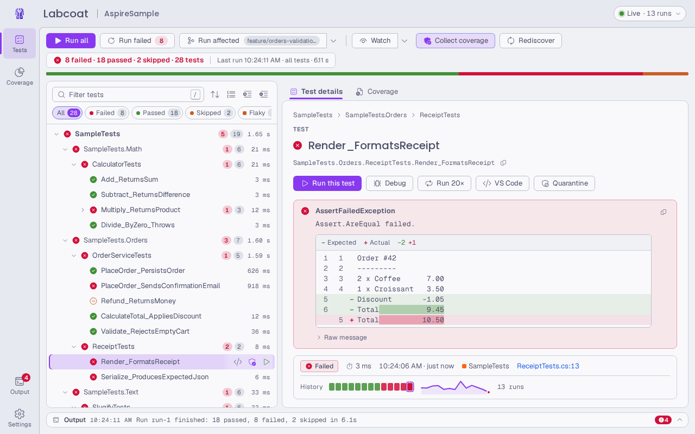 | 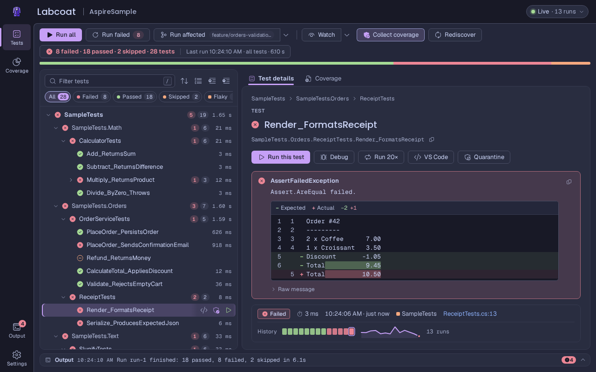 |
| Aspire | 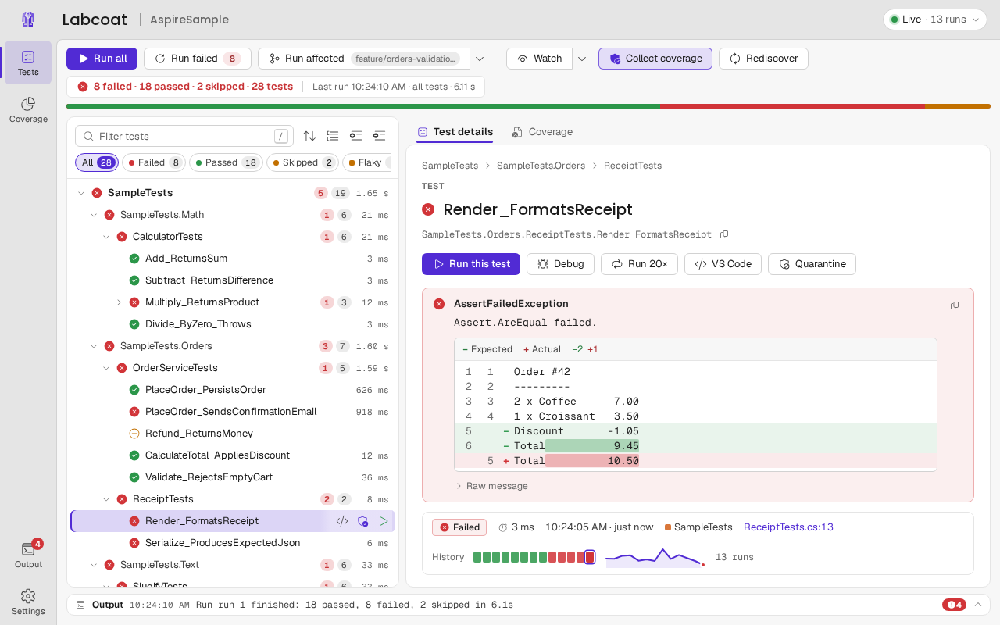 | 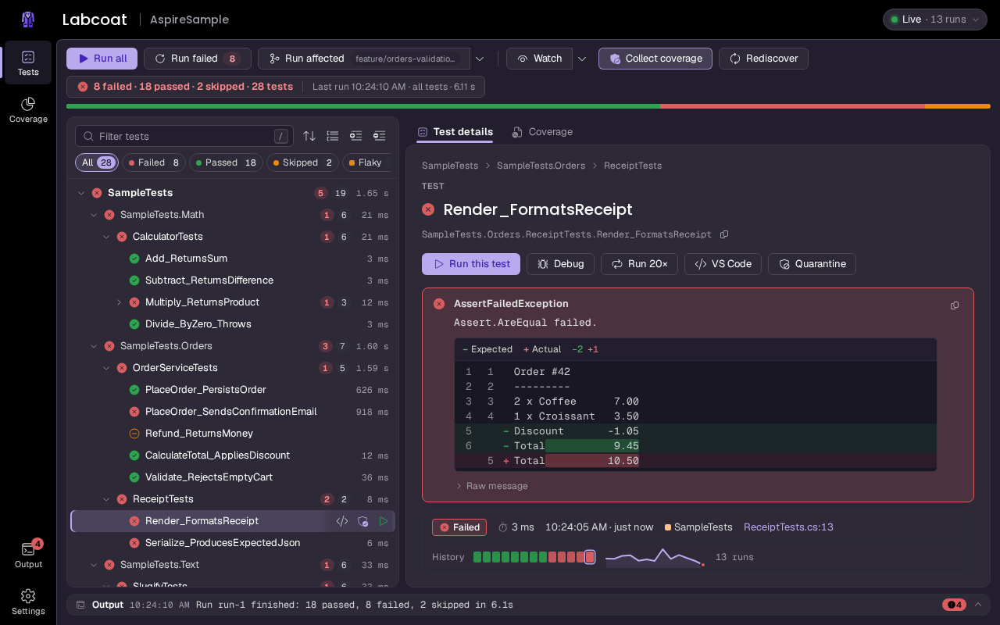 |
| GitHub | 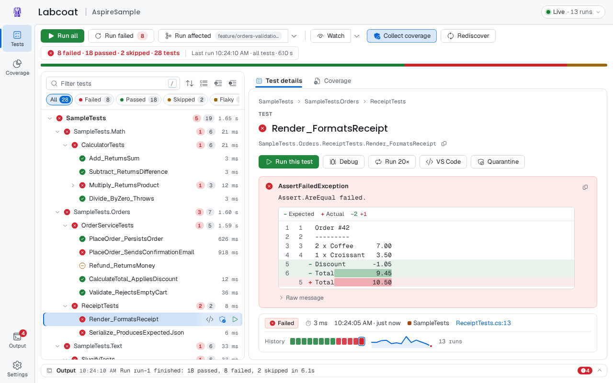 | 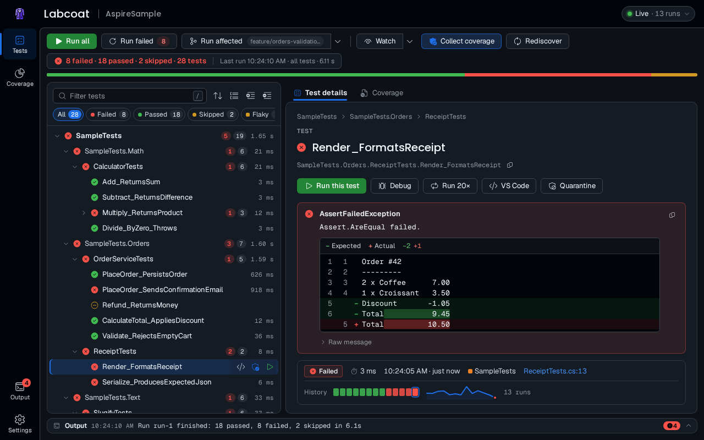 |
| One | 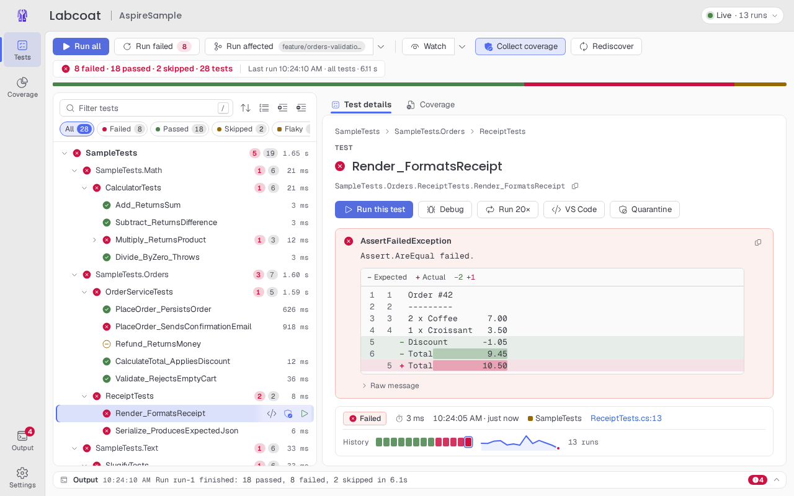 | 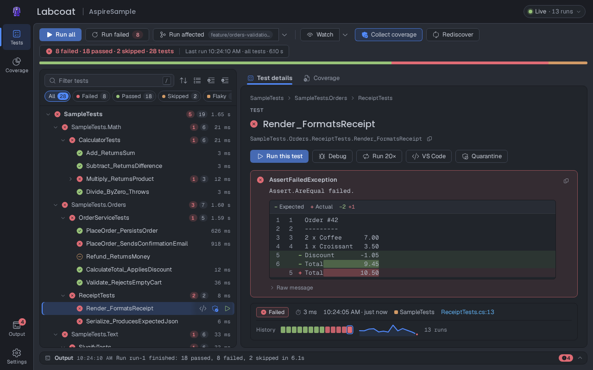 |
| Dracula | 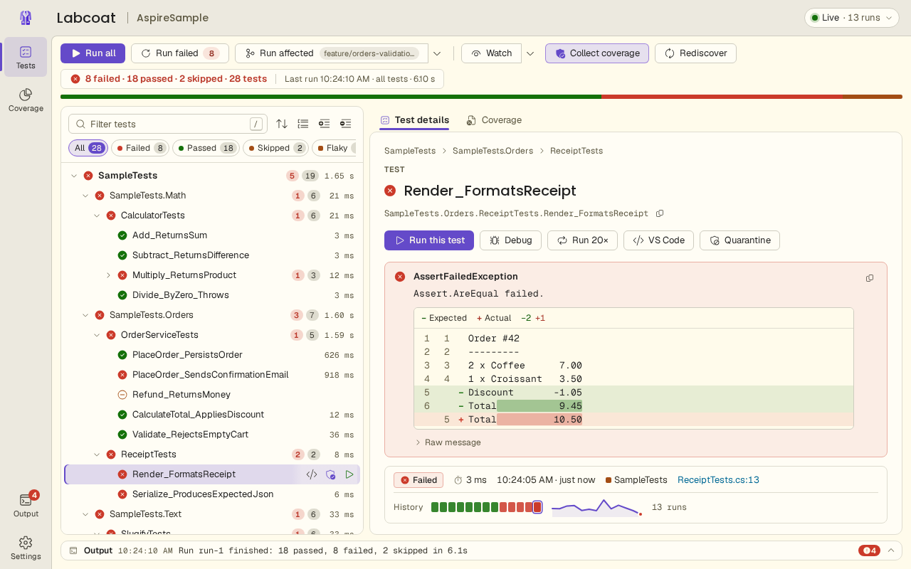 | 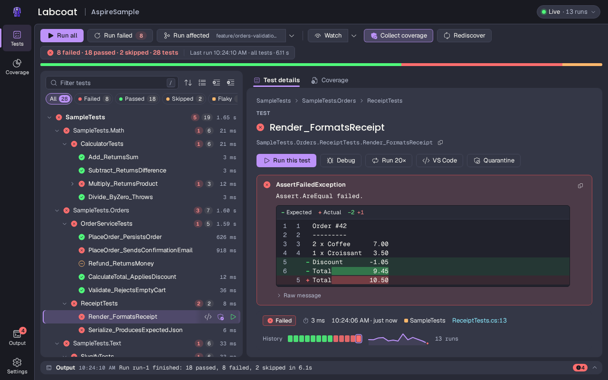 |
| Solarized | 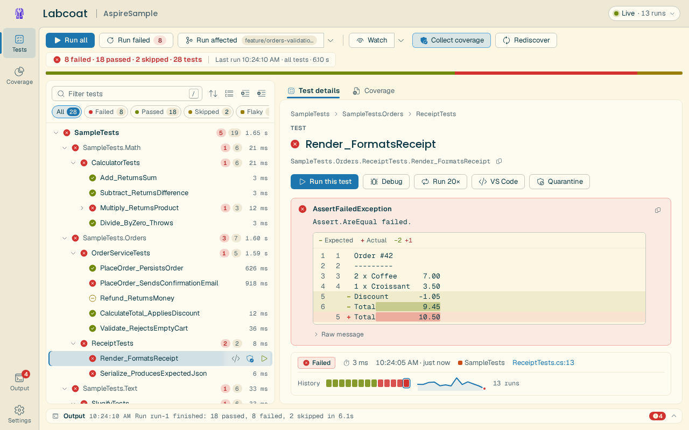 | 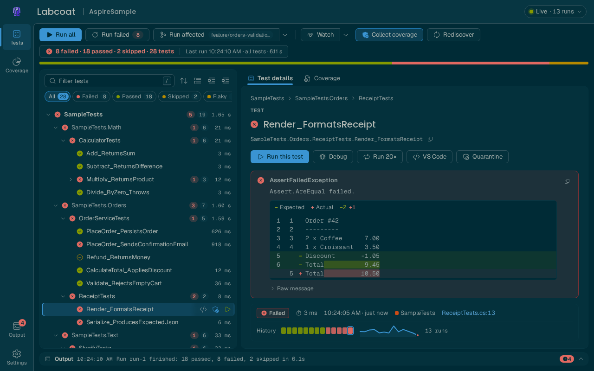 |
| Gruvbox | 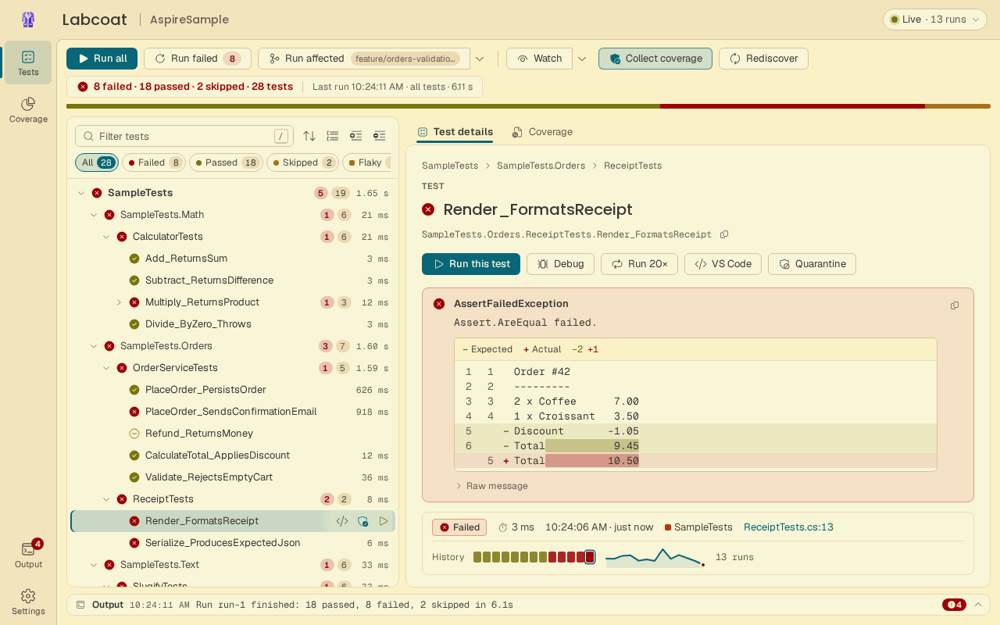 | 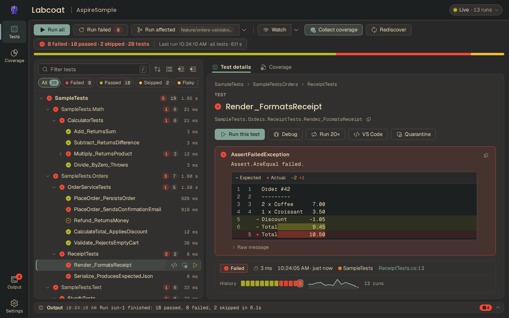 |

Every family is checked against WCAG 2.x contrast: at least 4.5:1 for text (including code and console colors on their
backgrounds) and 3:1 for icons, the focus ring and other UI elements. Where an original palette falls short, the
theme adjusts that one color and says so in a comment.

**Motion:** Settings › Appearance › Motion follows the operating system's reduce-motion setting by default. Reduced
keeps only short fades; Off turns all animations off.

## Customizing colors

The packaged tool has no option for your own stylesheet. To change colors, build the UI from source (see
[CONTRIBUTING.md](../CONTRIBUTING.md)) and either override tokens or add a family.

All colors in the UI come from semantic tokens (`--lc-*`, for example `--lc-accent`, `--lc-bg-page`, `--lc-fg`). A
theme file assigns those tokens and nothing else. The theme is selected by two attributes on `<html>`:

```html
<html data-theme-family="catppuccin" data-theme="dark">
```

To override a few tokens, add CSS that loads after the design system:

```css
/* a different accent for Aspire dark */
:root[data-theme-family="aspire"][data-theme="dark"] {
  --lc-accent: #ff9f1c;
  --lc-accent-hover: #ffbf69;
  --lc-on-accent: #1a1a1a;
  --lc-focus-ring: #ff9f1c;
}
```

To add a theme family, follow [Adding a theme family](../CONTRIBUTING.md#adding-a-theme-family). The full token
reference is in the [design system README](../ui/design-system/README.md#semantic-token-reference).

The palettes' licenses are in [THIRD-PARTY-NOTICES.md](../THIRD-PARTY-NOTICES.md).
